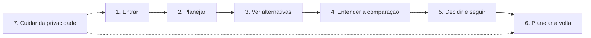

# Story map do app VoltaSegura

- **Status:** rascunho (Fase 1, 13/11/2026)
- **Fonte única de funcionalidades:** `docs/10_backlog_produto.md` (v1.2). Nenhuma tarefa aqui existe fora do backlog. Detalhes de interface que o backlog não cobre estão marcados `[HIPÓTESE]` e remetem a `12_pendencias_e_lacunas.md`.
- **Persona:** Ágatha Santos, 24 anos (proto-persona, não validada com usuários).
- **Jornada base:** Planejar → Analisar → Comparar → Decidir → Revisar (`docs/03` §4).

## Como ler

A **espinha** (linha de cima) é a sequência de **atividades** da Ágatha. Embaixo de cada atividade estão os **passos** e, embaixo deles, as **tarefas** com a história (US) e os critérios de aceite (AC) de origem. A fatia **MVP** é o que entra no protótipo da GS. A fatia **Posterior** vem da seção 9 do backlog e não entra nas telas.

## Espinha da jornada

A atividade 7 é transversal: fica disponível em qualquer momento, pelas configurações.

## Atividades, passos e tarefas

### 1. Entrar

| Passo | Tarefa | US / AC | Fluxo | Fatia |
|---|---|---|---|---|
| 1.1 Criar conta | Informar só e-mail e senha | US-01 AC1, AC4 | FL-02 | MVP |
| | Aceitar o aviso de privacidade (minuta acadêmica) | US-01 AC2, AC6 | FL-02 | MVP |
| | Ver recusa de e-mail já cadastrado | US-01 AC3 | FL-02 | MVP |
| | Criar conta com Google (só e-mail e identificador) | US-01 AC5 | FL-02 | MVP (demo depende de PL-06) |
| 1.2 Entrar | Entrar com e-mail e senha | US-02 AC1 | FL-03 | MVP |
| | Ver mensagem genérica de acesso negado | US-02 AC2 | FL-03 | MVP |
| | Ser levada ao login ao tentar consultar sem sessão | US-02 AC3 | FL-03 | MVP |

### 2. Planejar

| Passo | Tarefa | US / AC | Fluxo | Fatia |
|---|---|---|---|---|
| 2.1 Escolher a origem | Tocar no mapa, usar a localização atual ou escolher local salvo/exemplo (D-02) | US-05 AC1–AC3, US-06 | FL-04, FL-05 | MVP |
| | Seguir digitando/escolhendo se negar o GPS | US-05 AC2 | FL-05 | MVP |
| 2.2 Escolher o destino | Mesmas formas da origem (D-02) | US-06 | FL-04, FL-05 | MVP |
| 2.3 Informar o horário | Definir o horário de saída | US-06 AC1 | FL-04 | MVP |
| 2.4 Pedir as alternativas | Enviar a consulta com os campos válidos | US-06 AC1 | FL-04 | MVP |
| | Ver o campo faltante indicado | US-06 AC2 | FL-04 | MVP |
| | Ver aviso de fora da área atendida (D-05) | US-06 AC3 | FL-04 | MVP |
| | Ver aviso de origem igual ao destino | US-06 AC4 | FL-04 | MVP |
| 2.5 Reaproveitar trajeto | Escolher um trajeto do histórico local, se ativado | US-04 AC2 | FL-11 | MVP |

### 3. Ver alternativas

| Passo | Tarefa | US / AC | Fluxo | Fatia |
|---|---|---|---|---|
| 3.1 Ver a lista | Ver até 3 rotas, cada uma com o seu foco: menor tempo, menos caminhada ou menor exposição estimada (D-12) | US-08, D-12 | FL-06 | MVP |
| | Ver duração, caminhada, baldeações e trechos de cada rota; a de menor exposição estimada primeiro e já selecionada, quando existir, e as demais por tempo (D-23) | US-08 AC1, AC5 | FL-06 | MVP |
| | Ver os horários identificados como previstos (programados) | US-08 AC3 | FL-06 | MVP |
| 3.2 Ver no mapa | Ver o trajeto inteiro da alternativa selecionada (D-01) | US-08, D-01 | FL-06 | MVP |
| | Trocar de alternativa tocando no card | D-01, D-23 | FL-06 | MVP |
| 3.3 Casos sem comparação | Ver aviso de que não há transporte público no horário | US-08 AC2 | FL-06 | MVP |
| | Ver a única alternativa sem comparação | US-08 AC4 | FL-06 | MVP |

### 4. Entender a comparação

| Passo | Tarefa | US / AC | Fluxo | Fatia |
|---|---|---|---|---|
| 4.1 Ver o foco de exposição | Ver o foco "menor exposição estimada entre as alternativas avaliadas" só quando a rota vence cada uma das outras | US-11 AC1, US-13 AC2, D-01, D-12 | FL-07 | MVP |
| | Ver que nenhuma rota recebe esse foco nos demais casos, inclusive com `L = 0` | US-11 AC2–AC4, US-12, D-13 | FL-07 | MVP |
| 4.2 Abrir "Por que esta rota?" | Ver, nos trechos a pé, os motivos e os dados usados | D-01, D-08 | FL-07 | MVP |
| | Ver N, L e D da rota inteira, ou "não aplicável" quando `L = 0` | US-10 AC1, AC5 | FL-07 | MVP |
| | Ver o indicativo curto da situação, sem a regra (mistos = sem diferença clara) | D-01, D-11, US-12 AC1–AC2 | FL-07 | MVP |
| 4.3 Ver "Sobre os dados" | Ver a linha fixa no container e abrir fonte, período, data de atualização, cobertura e limitações | US-14 AC1–AC5, D-09 | FL-09 | MVP |
| | Ver os créditos das fontes | US-16 AC1–AC2 | FL-09 | MVP |
| 4.4 Ver detalhes por categoria | Ver Furto, Roubo e Ocorrências de trânsito de cada rota (corredor de ±100 m) e as parcelas | US-15 AC1–AC2, D-14 | FL-10 | MVP |
| | Ver o panorama municipal de homicídio e violência sexual só em detalhes | US-15 AC3 | FL-10 | MVP |

### 5. Decidir e seguir

| Passo | Tarefa | US / AC | Fluxo | Fatia |
|---|---|---|---|---|
| 5.1 Escolher | Escolher a alternativa (decisão da usuária, sem escolha automática) | US-13, US-11 AC5 | FL-07 | MVP |
| 5.2 Ver o passo a passo | Ver os trechos em ordem com embarque e desembarque (D-04) | US-09 AC1 | FL-14 | MVP |
| 5.3 Compartilhar a viagem | Enviar a um contato o link com trajeto e localização ao vivo (D-19, D-21) | US-21 AC1–AC2, AC5 | FL-15 | MVP (Depende do tempo) |
| | Ver o indicador "Compartilhando" e parar quando quiser | US-21 AC3 | FL-15 | MVP (Depende do tempo) |
| | Ter a sessão encerrada sozinha na chegada ou no tempo máximo | US-21 AC4, AC7 | FL-15 | MVP (Depende do tempo) |

### Atividade do contato (outro ator)

| Passo | Tarefa | US / AC | Fluxo | Fatia |
|---|---|---|---|---|
| C.1 Abrir o link | Abrir no app (ou ser orientado a instalar) e entrar | US-21 AC6, PL-23 | FL-16 | MVP (Depende do tempo) |
| C.2 Acompanhar | Ver trajeto, última posição, chegada estimada e estado até "Chegou" | US-21 AC6, AC8 | FL-16 | MVP (Depende do tempo) |

### 6. Planejar a volta

| Passo | Tarefa | US / AC | Fluxo | Fatia |
|---|---|---|---|---|
| 6.1 Inverter | Planejar a volta com origem e destino invertidos | US-07 AC1 | FL-08 | MVP |
| 6.2 Novo horário | Definir o horário da volta à parte | US-07 AC1–AC2 | FL-08 | MVP |

### 7. Cuidar da privacidade (transversal)

| Passo | Tarefa | US / AC | Fluxo | Fatia |
|---|---|---|---|---|
| 7.1 Histórico local | Ligar ou desligar o histórico (desligado por padrão) | US-04 AC1–AC2, AC4 | FL-11 | MVP |
| | Apagar um ou todos os trajetos salvos | US-04 AC3 | FL-11 | MVP |
| 7.2 Excluir conta | Excluir a conta com confirmação; cancelar sem apagar | US-03 AC1–AC3 | FL-12 | MVP |
| 7.3 Aviso de privacidade | Reler o aviso (minuta acadêmica) | US-01 AC6, RNF-09 | FL-02 | MVP |

## Fora das telas

**Itens de backend, sem tela própria:** F5.1 (US-17), F5.2 (US-18) e F6.1/F6.2 (US-19, US-20). Eles aparecem nas telas só como consequência: data de atualização (US-18 AC3), cobertura e "dados insuficientes" (US-17 AC3), nada de coordenadas individuais (US-20).

**Fatia Posterior (`docs/10` §9, não entra nas telas do MVP):** P-01 tempo real e replanejamento; ~~P-02 compartilhamento de trajeto~~ (antecipado como F2.5, passo 5.3); P-03 iluminação pública; P-04 preferências de mobilidade e acessibilidade; P-05 parcerias e outras cidades; P-06 teste de compreensão das mensagens.

## Requisitos transversais em todas as telas

RNF-01 (linguagem), RNF-02 (sem rótulo de bairro), RNF-03 (zero registro não vira vantagem), RNF-04 (confiança separada da exposição), RNF-06 (sem transferir culpa), RNF-07 (acessibilidade), RNF-08 (dados de exemplo identificados), RNF-09 (sem afirmar conformidade com a LGPD).
