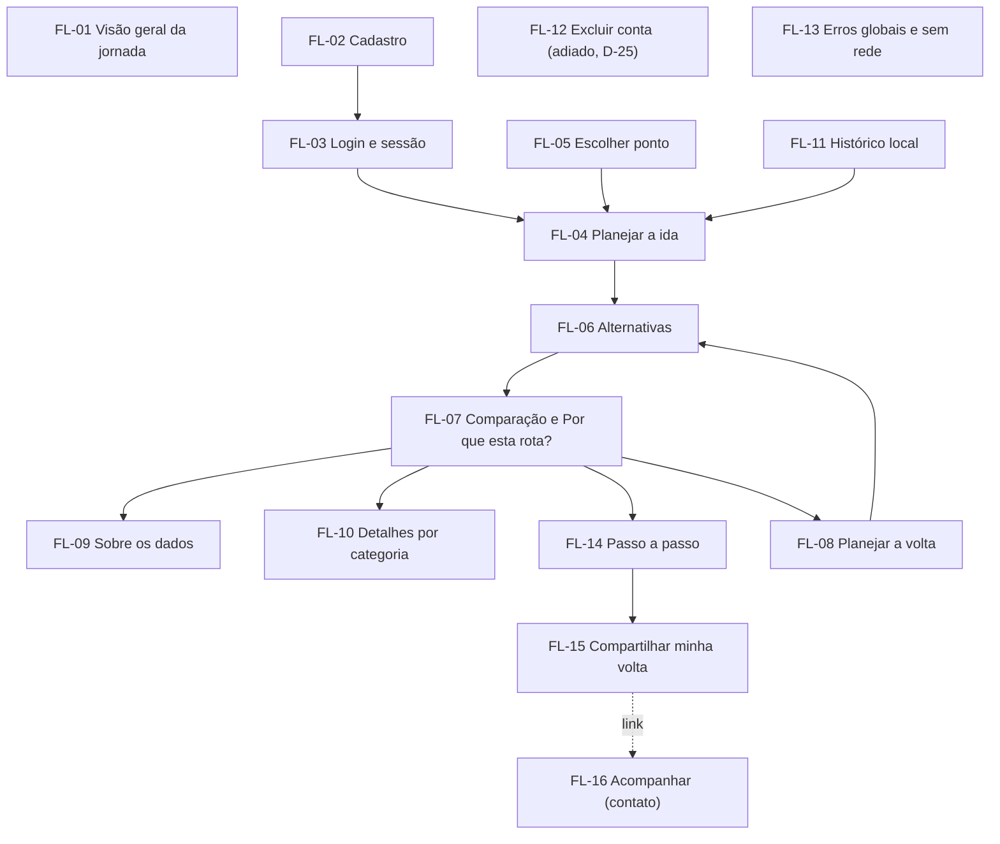

# Índice dos fluxogramas

- **Status do conjunto:** rascunho (Fase 1, 13/11/2026)
- **Formato:** Mermaid em Markdown (renderiza no GitHub e no VS Code). Um arquivo por fluxo, no template de `docs/plano_app.md` §4.2.
- **IDs de tela (TL-nn):** provisórios até a Fase 2 (`04_telas/`). Inventário usado nos fluxos:

| Tela | Nome provisório |
|---|---|
| TL-01 | Abertura |
| TL-02 | Criar conta |
| TL-03 | Entrar |
| TL-04 | Planejar (origem, destino, horário, ida/volta) |
| TL-05 | Escolher ponto no mapa |
| TL-06 | Buscando alternativas e avisos (sem serviço, fora da área, sem rede) |
| TL-07 | Resultado: mapa com o trajeto inteiro + container com as alternativas (D-01) |
| TL-08 | Detalhes da alternativa: trechos em ordem, ou seja, o passo a passo (D-04) |
| TL-09 | "Por que esta rota?" (D-01, PL-01) |
| TL-10 | Sobre os dados e fontes |
| TL-11 | Dados considerados: detalhes por categoria |
| TL-12 | Configurações: histórico local, excluir conta (adiado, D-25), aviso de privacidade |
| TL-13 | Aviso de privacidade (minuta acadêmica) |
| TL-14 | Compartilhar minha volta: confirmar e sessão ativa (Depende do tempo) |
| TL-15 | Acompanhar viagem (quem recebe o link; Depende do tempo) |

## Mapa geral

## Lista

| ID | Fluxo | US / AC principais | Arquivo |
|---|---|---|---|
| FL-01 | Visão geral da jornada | `docs/03` §4 | [FL-01](FL-01_visao_geral.md) |
| FL-02 | Cadastro com aviso de privacidade | US-01 | [FL-02](FL-02_cadastro.md) |
| FL-03 | Login e sessão | US-02 | [FL-03](FL-03_login_sessao.md) |
| FL-04 | Planejar a ida | US-06 | [FL-04](FL-04_planejar_ida.md) |
| FL-05 | Escolher ponto (mapa, GPS, locais) | US-05, US-06, D-02 | [FL-05](FL-05_escolher_ponto.md) |
| FL-06 | Alternativas com foco (até 3 rotas) | US-08, D-12 | [FL-06](FL-06_alternativas.md) |
| FL-07 | Comparação, foco de exposição e "Por que esta rota?" | US-10 a US-13, D-01, D-08 a D-13 | [FL-07](FL-07_comparacao.md) |
| FL-08 | Planejar a volta | US-07 | [FL-08](FL-08_planejar_volta.md) |
| FL-09 | Sobre os dados e fontes | US-14, US-16 | [FL-09](FL-09_sobre_os_dados.md) |
| FL-10 | Detalhes por categoria | US-15 | [FL-10](FL-10_detalhes_categorias.md) |
| FL-11 | Histórico local | US-04 | [FL-11](FL-11_historico_local.md) |
| FL-12 | Excluir conta — **adiado (D-25)** | US-03 | [FL-12](FL-12_excluir_conta.md) |
| FL-13 | Erros globais e sem rede | RNF, PL-12 | [FL-13](FL-13_erros_globais.md) |
| FL-14 | Passo a passo | US-09, D-04 | [FL-14](FL-14_passo_a_passo.md) |
| FL-15 | Compartilhar minha volta (Depende do tempo) | US-21, D-19 a D-22 | [FL-15](FL-15_compartilhar.md) |
| FL-16 | Acompanhar uma viagem (contato; Depende do tempo) | US-21 AC6–AC8, D-21 | [FL-16](FL-16_acompanhar.md) |

## Cobertura dos AC do MVP

Todos os AC das features MVP com tela (E1 a E4) aparecem em pelo menos um fluxo. A matriz completa (AC → fluxo → tela → teste) fica em `10_rastreabilidade.md` (Fase 4). As features de backend (F5.1, F5.2, F6.1, F6.2) aparecem nos fluxos só como regra aplicada.
