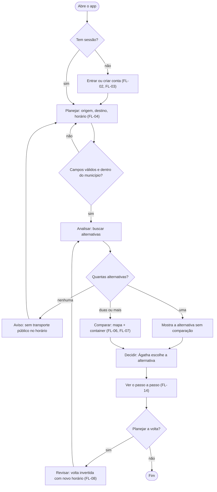

# FL-01 · Visão geral da jornada

- **Status:** rascunho · **Status das regras:** `[DECISÃO]` (`docs/03` §4; D-01 a D-05)
- **Ator e gatilho:** Ágatha abre o app para planejar a ida ou a volta.
- **Pré-condições:** app instalado.
- **Pós-condições:** Ágatha viu as alternativas, entendeu a comparação e escolheu a sua, ou foi informada de que não há o que comparar.
- **US/AC cobertos:** visão de conjunto; o detalhe fica nos fluxos FL-02 a FL-14.
- **Telas envolvidas:** TL-01 → TL-03 → TL-04 → TL-06 → TL-07 → TL-08/TL-09 → TL-04 (volta)

## Diagrama

## Passos

| Nº | Ação da usuária | Resposta do app | Tela | Dado/serviço |
|---|---|---|---|---|
| 1 | Abre o app | Verifica a sessão | TL-01 | Sessão no aparelho |
| 2 | Entra ou cria conta | Abre o planejamento | TL-02/TL-03 → TL-04 | Endpoints de conta (D-03) |
| 3 | Informa origem, destino e horário | Valida os campos | TL-04 | Local |
| 4 | Pede as alternativas | Mostra "buscando" e consulta | TL-06 | API de alternativas e comparação |
| 5 | Vê as alternativas | Mapa com o trajeto inteiro + container | TL-07 | Resposta da API |
| 6 | Abre os detalhes e "Por que esta rota?" | Mostra trechos e motivos | TL-08, TL-09 | Resposta da API |
| 7 | Escolhe e segue | Mostra o passo a passo | TL-08 | Resposta da API |
| 8 | Planeja a volta | Inverte origem e destino e pede o novo horário | TL-04 | Local |

## Caminho feliz

Sessão ativa → planejar ida → duas ou mais alternativas → comparação → Ágatha escolhe → passo a passo → planeja a volta → nova comparação no horário da volta.

## Caminhos alternativos

- Sem sessão: entra pelo FL-03 ou cria conta pelo FL-02.
- Usa um trajeto do histórico local (FL-11), se ativado.
- Uma única alternativa: aparece sem comparação (US-08 AC4).

## Erros e exceções

Campo inválido, origem igual ao destino, fora do município (FL-04); sem serviço no horário (FL-06); sem rede, tempo esgotado ou erro do servidor (FL-13); permissão de localização negada (FL-05).

## Regras de negócio e privacidade aplicáveis

DT-05 (faixa do dia por trecho a pé), DT-07 (regra de destaque), DT-08 (privacidade), US-11 AC5 (o app não escolhe pela usuária), RNF-01 a RNF-09.
