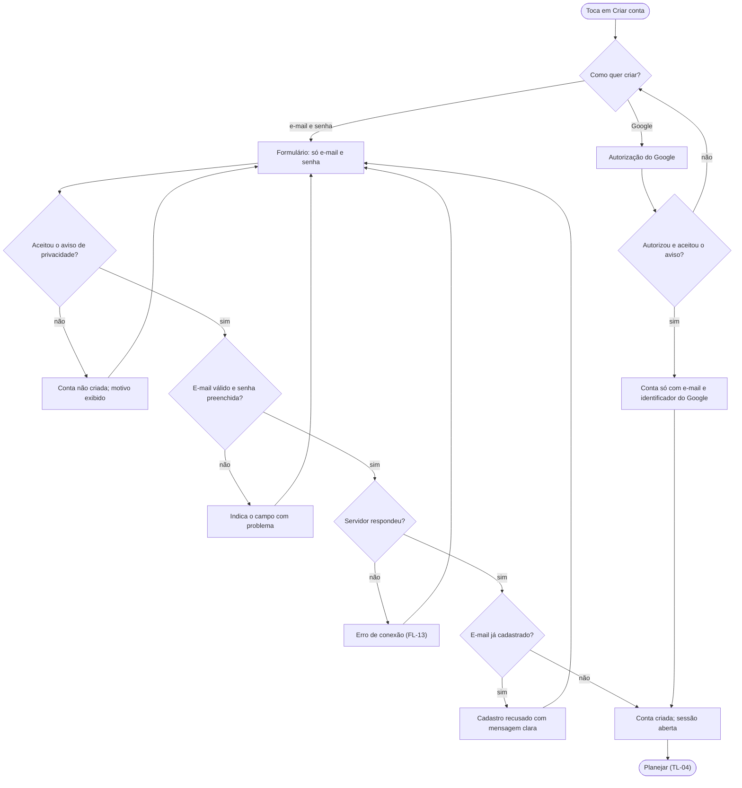

# FL-02 · Cadastro com aviso de privacidade

- **Status:** rascunho · **Status das regras:** `[DECISÃO]` (US-01, DT-08, D-03); regras de senha `[EM ABERTO]` (PL-07); Google na demo depende de PL-06
- **Ator e gatilho:** Ágatha, sem conta, toca em "Criar conta" na abertura ou no login.
- **Pré-condições:** sem sessão ativa.
- **Pós-condições:** conta criada só com e-mail (e identificador) e sessão aberta; ou cadastro recusado com o motivo.
- **US/AC cobertos:** US-01 AC1–AC6
- **Telas envolvidas:** TL-01 → TL-02 → TL-13 (ler o aviso) → TL-04

## Diagrama

## Passos

| Nº | Ação da usuária | Resposta do app | Tela | Dado/serviço |
|---|---|---|---|---|
| 1 | Toca em "Criar conta" | Abre o formulário com e-mail, senha e aceite do aviso | TL-02 | — |
| 2 | Toca em "Ler o aviso" (opcional) | Abre a minuta acadêmica | TL-13 | Texto fixo |
| 3 | Preenche e aceita o aviso | Valida formato do e-mail e senha não vazia | TL-02 | Local |
| 4 | Envia | Mostra carregando e chama o cadastro | TL-02 | Endpoint de cadastro (contrato, PL-05) |
| 5 | — | Conta criada: abre o planejamento | TL-04 | Sessão guardada no aparelho |

## Caminho feliz

E-mail e senha válidos, aviso aceito, e-mail novo → conta criada → TL-04.

## Caminhos alternativos

- Cadastro com Google: o app recebe só e-mail e identificador, sem nome nem foto (AC5). Na demo, se o OAuth não estiver pronto, o botão fica fora (PL-06).
- Ágatha lê o aviso antes de aceitar (TL-13) e volta ao formulário.

## Erros e exceções

| Situação | Resposta | AC |
|---|---|---|
| Aviso não aceito | Conta não criada; motivo exibido | AC2 |
| E-mail já cadastrado | Recusa com mensagem clara | AC3 |
| E-mail inválido ou senha vazia | Recusa; campo indicado | AC4 |
| Sem rede, tempo esgotado, erro do servidor | Mensagem de erro, dados digitados preservados (FL-13) | — |

## Regras de negócio e privacidade aplicáveis

- Só e-mail e senha; nenhum campo de nome, telefone ou endereço (AC1, DT-08).
- O aviso de privacidade é **minuta acadêmica**, sem revisão jurídica, e nenhum texto afirma conformidade com a LGPD (AC6, RNF-09).
- Regras de senha `[EM ABERTO]` (PL-07).
