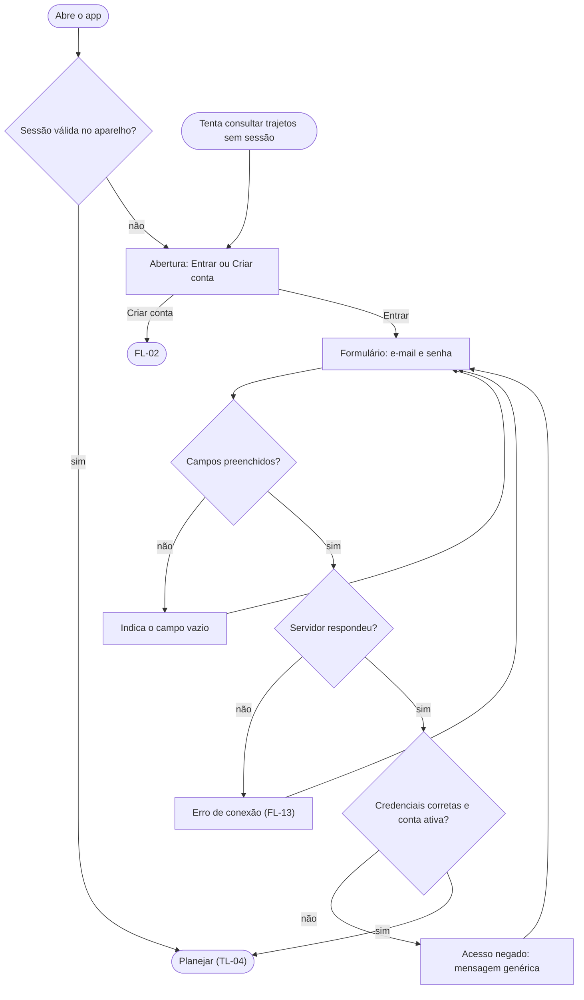

# FL-03 · Login e sessão

- **Status:** rascunho · **Status das regras:** `[DECISÃO]` (US-02, DT-08, D-03)
- **Ator e gatilho:** Ágatha abre o app ou tenta consultar trajetos.
- **Pré-condições:** conta existente (para o caminho feliz).
- **Pós-condições:** sessão aberta e TL-04 exibida; ou acesso negado com mensagem genérica.
- **US/AC cobertos:** US-02 AC1–AC3; US-03 AC2 (conta excluída não entra)
- **Telas envolvidas:** TL-01 → TL-03 → TL-04

## Diagrama

## Passos

| Nº | Ação da usuária | Resposta do app | Tela | Dado/serviço |
|---|---|---|---|---|
| 1 | Abre o app | Confere a sessão guardada | TL-01 | Sessão no aparelho |
| 2 | Toca em "Entrar" | Abre e-mail e senha | TL-03 | — |
| 3 | Envia | Mostra carregando e chama o login | TL-03 | Endpoint de login (contrato, PL-05) |
| 4 | — | Abre o planejamento | TL-04 | Sessão guardada |

## Caminho feliz

Credenciais corretas → TL-04 (AC1).

## Caminhos alternativos

- Sessão válida ao abrir: vai direto para TL-04.
- Entrar com Google (se disponível, PL-06).
- Sessão expirada durante o uso: volta para TL-03 e, depois do login, retorna ao planejamento.

## Erros e exceções

| Situação | Resposta | AC |
|---|---|---|
| Senha errada ou e-mail inexistente | Mensagem genérica, sem dizer qual dos dois está errado | US-02 AC2 |
| Conta excluída | Mesma mensagem genérica | US-03 AC2 |
| Sem sessão ao consultar | Pede login (conta obrigatória) | US-02 AC3 |
| Sem rede ou erro do servidor | FL-13 | — |

## Regras de negócio e privacidade aplicáveis

Conta obrigatória para consultar (DT-08). A sessão fica guardada só no aparelho. Logs não vinculam conta a consultas (US-19 AC2).
