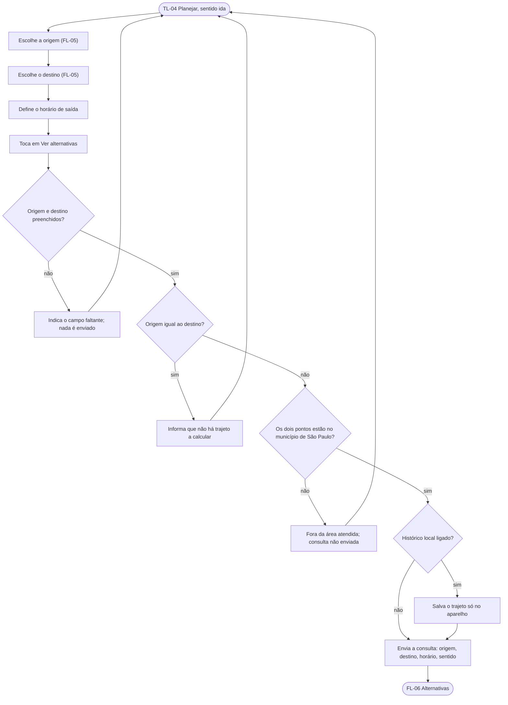

# FL-04 · Planejar a ida

- **Status:** rascunho · **Status das regras:** `[DECISÃO]` (US-06, D-02, D-05); checagem do limite do município `[HIPÓTESE]` (PL-11)
- **Ator e gatilho:** Ágatha, logada, quer ver as alternativas de um trajeto.
- **Pré-condições:** sessão ativa (FL-03).
- **Pós-condições:** consulta enviada (vai para FL-06) ou campo indicado / aviso exibido sem enviar.
- **US/AC cobertos:** US-06 AC1–AC4; US-02 AC3; US-04 AC1–AC2 (salvar no histórico local, se ligado)
- **Telas envolvidas:** TL-04 → TL-05 (escolher ponto) → TL-06 → TL-07

## Diagrama

## Passos

| Nº | Ação da usuária | Resposta do app | Tela | Dado/serviço |
|---|---|---|---|---|
| 1 | Abre o planejamento | Mostra origem, destino, horário (padrão: agora) e sentido "ida" | TL-04 | Local |
| 2 | Toca em origem | Abre as opções de ponto | TL-04 → TL-05 | FL-05 |
| 3 | Toca em destino | Idem | TL-04 → TL-05 | FL-05 |
| 4 | Ajusta o horário | Seletor de horário | TL-04 | Local |
| 5 | Toca em "Ver alternativas" | Valida e envia | TL-04 → TL-06 | API de alternativas e comparação |

## Caminho feliz

Origem e destino diferentes, dentro do município, horário definido → consulta enviada (AC1).

## Caminhos alternativos

- Escolhe um trajeto do histórico local (FL-11): origem e destino já vêm preenchidos.
- Usa a localização atual como origem (FL-05, US-05).

## Erros e exceções

| Situação | Resposta | AC |
|---|---|---|
| Origem ou destino vazio | Não envia; indica o campo | AC2 |
| Ponto fora do município | Não envia; "fora da área atendida (município de São Paulo)" | AC3, D-05 |
| Origem igual ao destino | Informa que não há trajeto a calcular | AC4 |
| Sem rede | FL-13 (não envia) | PL-12 |

## Regras de negócio e privacidade aplicáveis

- A consulta leva origem, destino, horário e sentido só para o cálculo; o servidor não grava (US-19 AC1).
- Nenhum envio de origem ou destino a serviço externo de mapas (US-19 AC3, D-02).
- O horário define a faixa do dia de cada trecho a pé (DT-05); o app não mostra essa regra na tela principal (D-01).
- Histórico: só no aparelho e só se ligado (US-04 AC1, AC2, AC4).
