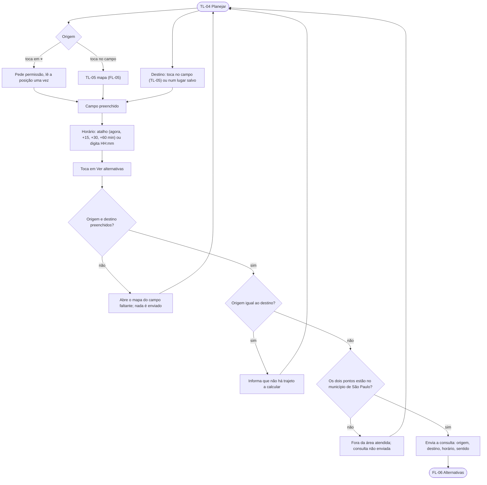

# FL-04 · Planejar (ida e volta)

- **Status:** rascunho, **revisto pela D-29 (14/11/2026)** · **Status das regras:** `[DECISÃO]` (US-06, D-02 revista, D-05, D-29); checagem do limite do município `[HIPÓTESE]` (PL-11)
- **Ator e gatilho:** Ágatha, logada, quer ver as alternativas de um trajeto (qualquer sentido: não há mais escolha Ida/Volta na tela).
- **Pré-condições:** sessão ativa (FL-03).
- **Pós-condições:** consulta enviada (FL-06) ou campo indicado / aviso exibido sem enviar.
- **US/AC cobertos:** US-06 AC1–AC4; US-05; US-02 AC3
- **Telas envolvidas:** TL-04 → TL-05 → TL-04 → TL-06 → TL-07

## Diagrama

## Passos
| Nº | Ação da usuária | Resposta do app | Tela | Dado/serviço |
|---|---|---|---|---|
| 1 | Abre o app | Home com origem, destino, atalhos de horário e lugares salvos | TL-04 | Local |
| 2 | Toca em De onde | Abre o mapa (ou, com ⌖, preenche com a localização) | TL-04 → TL-05 | FL-05, GPS |
| 3 | Toca em Para onde ou num lugar salvo | Abre o mapa ou preenche o destino | TL-04 → TL-05 | FL-05, local |
| 4 | Escolhe o horário | Atalho ou HH:mm | TL-04 | Local |
| 5 | Toca em Ver alternativas | Valida e envia | TL-04 → TL-06 | API |

## Caminhos alternativos
- Vindo de "Planejar a volta" (FL-08): pontos já invertidos, etiqueta "Planejando a volta".
- "Inverter" troca origem e destino a qualquer momento.
- Histórico de trajetos: não existe (FL-11, `[EM ABERTO]`).

## Erros e exceções
| Situação | Resposta | AC |
|---|---|---|
| Origem ou destino vazio | Não envia; abre o mapa do campo faltante | AC2 |
| Ponto fora do município | Não envia; "fora da área atendida" | AC3, D-05 |
| Origem igual ao destino | Informa que não há trajeto a calcular | AC4 |
| Permissão de localização negada (⌖) | Aviso; mapa e busca seguem | US-05 AC2 |
| Sem rede | FL-13 (não envia) | PL-12 |

## Regras de negócio e privacidade aplicáveis
- A consulta leva origem, destino, horário e sentido só para o cálculo; o servidor não grava (US-19 AC1).
- Nenhum dado de origem ou destino vai a serviço externo de mapas por conta do app; a **busca por texto** (FL-05) envia só o texto digitado ao geocodificador do sistema (D-29).
- O horário define a faixa do dia de cada trecho a pé (DT-05) e não aparece como regra na tela (D-01).
