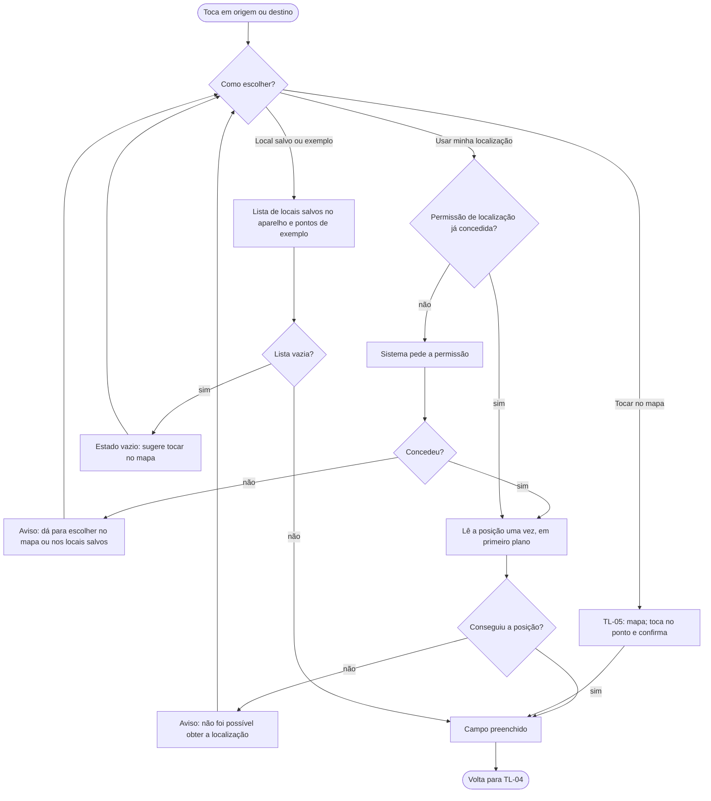

# FL-05 · Escolher ponto (mapa, GPS, locais salvos)

- **Status:** rascunho · **Status das regras:** `[DECISÃO]` (D-02, US-05); nome do ponto `[HIPÓTESE]` (PL-09); mapa base externo (PL-03)
- **Ator e gatilho:** Ágatha toca no campo de origem ou de destino em TL-04.
- **Pré-condições:** TL-04 aberta.
- **Pós-condições:** campo preenchido com um ponto, ou mantido vazio se ela desistir.
- **US/AC cobertos:** US-05 AC1–AC3; US-06 (preenchimento dos campos); US-04 AC2 (locais vindos do histórico local)
- **Telas envolvidas:** TL-04 → TL-05 → TL-04

## Diagrama

## Passos

| Nº | Ação da usuária | Resposta do app | Tela | Dado/serviço |
|---|---|---|---|---|
| 1 | Toca no campo | Mostra as três opções | TL-04 | — |
| 2a | "Usar minha localização" | Pede permissão (se preciso) e lê a posição uma vez | TL-04 | GPS do aparelho |
| 2b | "Escolher no mapa" | Abre o mapa; ela toca e confirma | TL-05 | Mapa base (PL-03) |
| 2c | "Locais salvos" | Lista do aparelho + pontos de exemplo rotulados | TL-04 | Armazenamento local |
| 3 | — | Campo mostra o nome do local ou "Ponto escolhido no mapa" | TL-04 | Local (PL-09) |

## Caminho feliz

Escolhe por qualquer uma das três formas → campo preenchido → volta a TL-04.

## Caminhos alternativos

- Pontos de exemplo da demo, sempre com aviso de exemplo (RNF-08).
- Ao confirmar um ponto no mapa, Ágatha pode dar um nome e salvá-lo no aparelho `[HIPÓTESE]` (PL-09).

## Erros e exceções

| Situação | Resposta | AC |
|---|---|---|
| Permissão negada | Segue com mapa ou locais salvos | US-05 AC2 |
| Falha ao ler a posição | Aviso e volta às opções | — |
| Lista de locais vazia | Estado vazio com sugestão | — |
| Mapa não carrega (sem rede) | FL-13; locais salvos continuam disponíveis | PL-12 |

## Regras de negócio e privacidade aplicáveis

- GPS só nesta ação, em primeiro plano, nunca em segundo plano (US-05 AC3).
- Sem busca de endereço em serviço externo (US-19 AC3, D-02).
- Mapa sem marcadores de ocorrência e sem rótulo de bairro (US-15 AC4, RNF-02).
- Atribuição "© OpenStreetMap contributors" visível no mapa (US-16 AC1).
- Locais salvos ficam só no aparelho (US-04 AC4).
