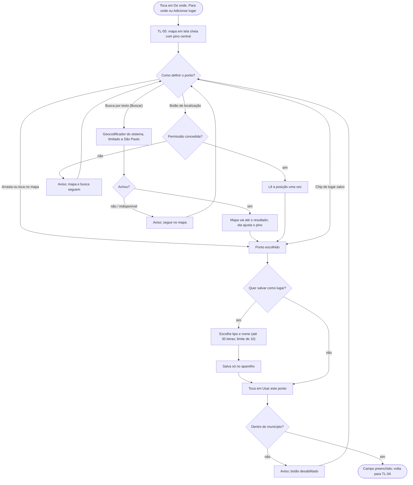

# FL-05 · Escolher ponto (mapa, busca, localização, lugares salvos)

- **Status:** rascunho, **revisto pela D-29 (14/11/2026)** · **Status das regras:** `[DECISÃO]` (D-29, US-05); nome do ponto `[HIPÓTESE]` (PL-09, U2); mapa base externo (PL-03)
- **Ator e gatilho:** Ágatha toca em De onde, Para onde ou Adicionar lugar em TL-04.
- **Pré-condições:** TL-04 aberta.
- **Pós-condições:** campo preenchido com um ponto (e, se quiser, o ponto salvo como lugar), ou campo mantido se ela fechar.
- **US/AC cobertos:** US-05 AC1–AC3; US-06 AC5 (revisto); US-04 AC5
- **Telas envolvidas:** TL-04 → TL-05 → TL-04

## Diagrama

## Passos
| Nº | Ação da usuária | Resposta do app | Tela | Dado/serviço |
|---|---|---|---|---|
| 1 | Toca no campo | Abre o mapa em tela cheia | TL-05 | Mapa base (PL-03) |
| 2a | Arrasta o mapa ou toca | Pino no ponto; painel mostra "Ponto escolhido" | TL-05 | Local |
| 2b | Digita e toca em Buscar | Mapa vai ao lugar (primeiro resultado) | TL-05 | Geocodificador do sistema |
| 2c | Toca no botão de localização | Pede permissão e lê a posição uma vez | TL-05 | GPS |
| 2d | Toca num chip de lugar salvo | Ponto = lugar salvo, com o nome dele | TL-05 | SecureStore |
| 3 | (opcional) Salvar este lugar | Tipo + nome → salva no aparelho | TL-05 | SecureStore |
| 4 | Usar este ponto | Preenche o campo e volta | TL-05 → TL-04 | Local |

## Caminhos alternativos
- Fechar sem escolher: volta sem mudar nada.
- Sem mapa (web/falha): mensagem; busca, localização e lugares salvos seguem.

## Erros e exceções
| Situação | Resposta | AC |
|---|---|---|
| Permissão negada | Aviso; segue com mapa, busca e lugares | US-05 AC2 |
| Falha ao ler a posição | Aviso "Não foi possível obter a localização." | — |
| Busca sem resultado | "Não encontramos esse endereço..." | — |
| Busca indisponível (sem geocodificador) | "A busca por texto não está disponível agora..." | — |
| Nome vazio ao salvar | "Dê um nome para salvar o lugar." | — |
| Mais de 10 lugares | "Você chegou ao limite de 10 lugares..." | — |
| Ponto fora do município | Aviso e confirmar desabilitado | D-05 |

## Regras de negócio e privacidade aplicáveis
- **Busca por texto (D-29, revê D-02):** só ao tocar em Buscar, mínimo de 3 letras, texto enviado ao serviço de mapas do sistema, nada guardado nem registrado (US-19 AC2); citado no aviso de privacidade `[HIPÓTESE]`.
- GPS só nesta ação, em primeiro plano (US-05 AC3).
- **Sem pontos de exemplo na interface.**
- Mapa sem marcadores de ocorrência nem rótulo de bairro (US-15 AC4, RNF-02); atribuição visível (US-16 AC1).
- Lugares salvos: só no aparelho, cifrados (US-04 AC4–AC5).
