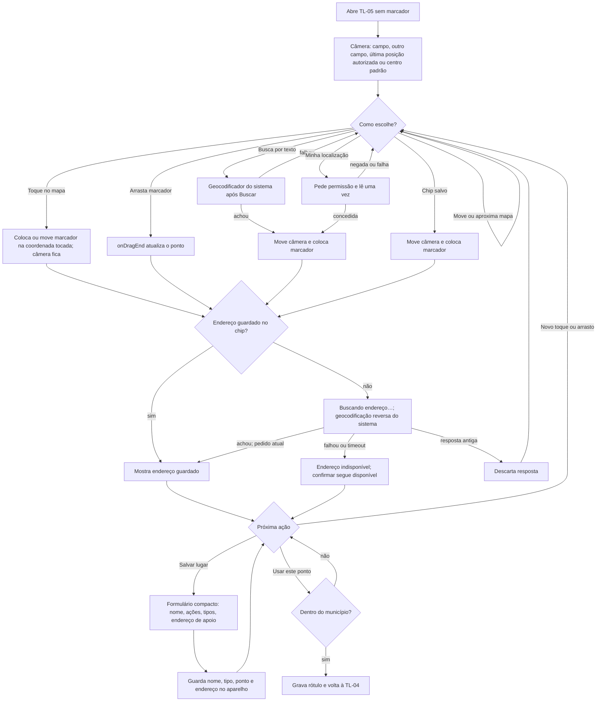

# FL-05 · Escolher ponto

- **Status:** revisão de implementação em 15/11/2026 por D-30 e pedido de Lucas sobre marcador por toque. Textos novos `[HIPÓTESE]`.
- **Ator e gatilho:** a pessoa toca em De onde, Para Onde ou Adicionar lugar na TL-04.
- **Pós-condição:** campo preenchido com ponto e rótulo, ou mantido ao fechar sem confirmar.

## Diagrama

## Regras e exceções

- `[DECISÃO]` A abertura contextual não solicita nova permissão nem escolhe ponto. Se a pessoa interagir antes da leitura da última posição, a leitura não recentra a câmera.
- `[DECISÃO]` Mover o mapa não muda o marcador. Toque e fim do arrasto do marcador substituem o ponto; busca, GPS e lugar salvo também movem a câmera.
- `[DECISÃO]` D-30: `reverseGeocodeAsync` recebe as coordenadas pelo serviço de mapas do sistema, sem servidor do projeto ou log. Resposta antiga é descartada. Timeout e erro deixam o ponto confirmável.
- `[DECISÃO]` Endereço no painel: até duas linhas. Na consulta, endereço limitado a 60 caracteres; exceções: rótulo “Minha localização” e nome do lugar salvo. Busca textual sem endereço usa o texto digitado.
- `[HIPÓTESE]` Busca usa serviço de mapas do sistema só após confirmação; o aviso curto aparece em pílula com foco ou texto.
- `[EM ABERTO]` Validação física do formulário compacto com teclado e fonte a 130% e 200%.
