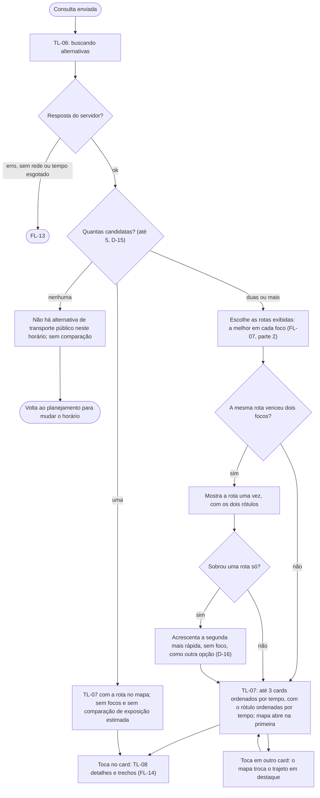

# FL-06 · Alternativas com foco

- **Status:** rascunho · **Status das regras:** `[DECISÃO]` (US-08, DT-01, DT-02, D-01, D-10, D-12, D-15, D-16)
- **Ator e gatilho:** consulta válida enviada pelo FL-04 ou pelo FL-08.
- **Pré-condições:** sessão ativa; consulta validada.
- **Pós-condições:** TL-07 exibida com **até 3 rotas**, cada uma com o seu foco; ou aviso de que não há transporte público no horário.
- **US/AC cobertos:** US-08 AC1–AC4
- **Telas envolvidas:** TL-06 → TL-07 → TL-08

## Diagrama

## Focos (D-12)

| Foco | Rótulo no card | Quando aparece |
|---|---|---|
| Menor tempo total | "Menor tempo" | Sempre que houver duas ou mais candidatas |
| Menos caminhada | "Menos caminhada" | Sempre que houver duas ou mais candidatas |
| Menor exposição estimada | "Menor exposição estimada" (texto completo no "Por que esta rota?": "Menor exposição estimada entre as alternativas avaliadas") | Só quando a regra conclui contra **cada** uma das outras candidatas (FL-07) |

| Outra opção (D-16) | "Outra opção" | Só quando os focos resultam numa rota só e há duas ou mais candidatas: a segunda mais rápida, sem foco |

**Candidatas:** até 5 alternativas devolvidas pelo roteamento (D-15). Uma rota que vence dois focos aparece **uma vez com os dois rótulos**. Com duas ou mais candidatas, a consulta mostra 2 ou 3 rotas, nunca uma só (D-16).

## Passos

| Nº | Ação da usuária | Resposta do app | Tela | Dado/serviço |
|---|---|---|---|---|
| 1 | — | Mostra "buscando alternativas" | TL-06 | API |
| 2 | — | Desenha no mapa o trajeto inteiro da primeira rota (a mais rápida); as outras em traço claro | TL-07 | Resposta da API |
| 3 | Lê os cards | Cada card: rótulo(s) de foco, duração total, caminhada, baldeações, modos e linhas, horário previsto | TL-07 | Resposta da API |
| 4 | Toca em outro card | Troca o trajeto em destaque no mapa | TL-07 | Local |
| 5 | Abre os detalhes | Mostra os trechos em ordem | TL-08 | Resposta da API |

## Caminho feliz

Duas ou mais candidatas → até 3 rotas com foco → Ágatha compara e abre os detalhes.

## Caminhos alternativos

- **Uma candidata só:** aparece sem foco e sem comparação de exposição estimada (US-08 AC4).
- **Mesma rota vence menor tempo e menos caminhada, sem foco de exposição:** aparece com os dois rótulos, e a segunda mais rápida entra como "outra opção" (D-16).

## Erros e exceções

| Situação | Resposta | AC |
|---|---|---|
| Sem serviço no horário | "Não há alternativa de transporte público neste horário"; nenhuma comparação | AC2 |
| Sem rede, tempo esgotado, erro do servidor | FL-13 | — |

## Regras de negócio e privacidade aplicáveis

- Horários **programados** (GTFS), identificados como **previstos**, não em tempo real (AC3, DT-02).
- Cada foco é um critério separado; nada vira nota única, e o app não escolhe pela usuária (US-11 AC5, US-13 AC1).
- "Por segurança" e equivalentes são proibidos (`docs/05`, RNF-01).
- Mapa sem marcadores de ocorrência nem rótulo de bairro (US-15 AC4, RNF-02); atribuição OSM e SPTrans (US-16).
- Dados de exemplo da demo rotulados como exemplo (RNF-08).
