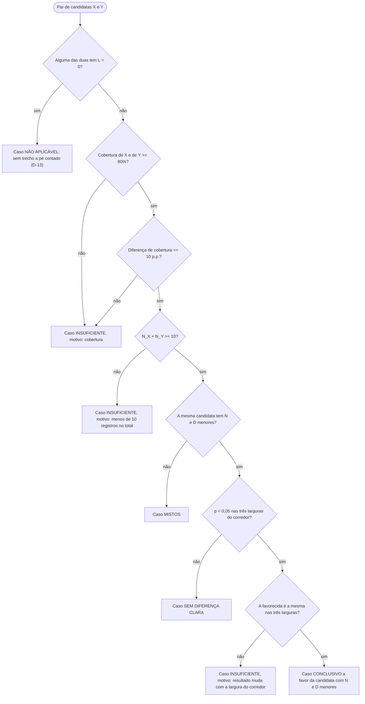
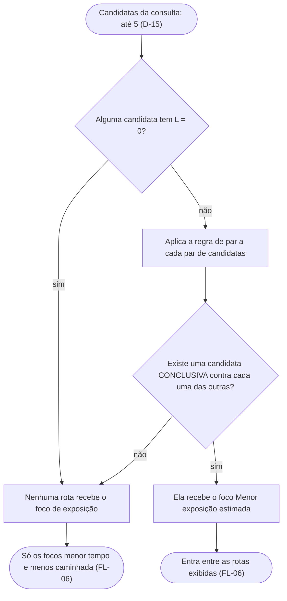
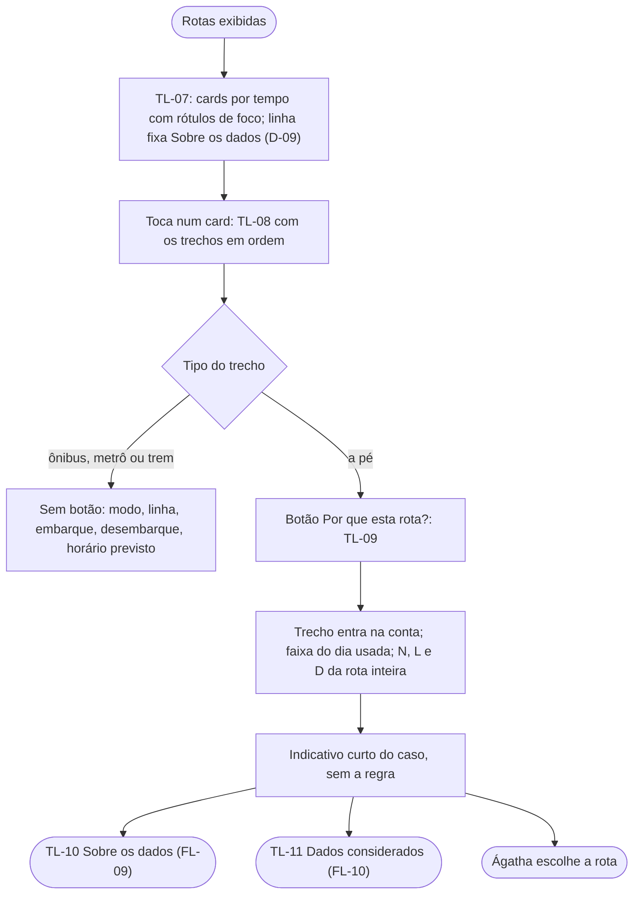

# FL-07 · Comparação, foco de exposição e "Por que esta rota?"

- **Status:** rascunho · **Status das regras:** regra de par `[DECISÃO]` (DT-03 a DT-07, `docs/08`); três ou mais candidatas, `L = 0` e mistos `[DECISÃO — 13/11/2026]` (D-11 a D-13); apresentação `[DECISÃO]` (D-01, D-08 a D-10, D-14); candidatas `[DECISÃO]` (D-15: até 5)
- **Ator e gatilho:** o FL-06 recebe duas ou mais candidatas.
- **Pré-condições:** resposta da API com as candidatas e os resultados da comparação. **O app não calcula estatística:** só exibe o que a API devolve.
- **Pós-condições:** Ágatha vê as rotas com os seus focos, entende os motivos e escolhe.
- **US/AC cobertos:** US-10 AC1–AC6; US-11 AC1–AC5; US-12 AC1–AC3; US-13 AC1–AC4; US-14 AC1, AC4; RNF-03, RNF-04
- **Telas envolvidas:** TL-07 → TL-08 → TL-09 → TL-10 / TL-11

## Parte 1: regra de par (o que a API resolve para cada par X e Y)

Documenta a regra do `docs/08`. Ela roda no servidor; o app só recebe o caso resultante e os números.

## Parte 2: foco de exposição com três ou mais candidatas (D-12, D-13)

Com exatamente duas candidatas, a Parte 2 é a própria regra de par.

## Parte 3: o que o app mostra (D-01, D-08 a D-11, D-14)

## Matriz de casos

| Caso (regra do `docs/08`) | Foco de exposição em TL-07 | Indicativo no "Por que esta rota?" | N, L, D | AC |
|---|---|---|---|---|
| CONCLUSIVO contra cada uma das outras | Sim, só na rota vencedora | Os registros mostram diferença entre as alternativas avaliadas | Sim | US-11 AC1 |
| MISTOS | Não | **Mesmo indicativo** de "sem diferença clara" (D-11) | Sim | US-11 AC2 |
| SEM DIFERENÇA CLARA (`p >= 0,05`) | Não | Os registros não mostram diferença clara entre as alternativas | Sim | US-11 AC3 |
| INSUFICIENTE: largura | Não | Dados insuficientes para comparar, motivo em linguagem simples | Sim (descritivo) | US-11 AC4 |
| INSUFICIENTE: amostra (`N_X + N_Y < 10`) | Não | Dados insuficientes: poucos registros no total | Motivo, sem ranking | US-12 AC1 |
| INSUFICIENTE: cobertura | Não | Dados insuficientes: cobertura dos dados nesta região | Motivo, sem ranking | US-12 AC2 |
| NÃO APLICÁVEL (`L = 0`) | Não, em nenhuma rota (D-13) | A rota não tem trecho a pé contado | D "não aplicável" | US-10 AC5 |
| Uma candidata só | Não | Sem comparação; só os dados da rota | — | US-08 AC4 |

Com três ou mais candidatas e sem vencedora, o indicativo mostrado é o do par que impediu a conclusão `[HIPÓTESE]`: se algum par for INSUFICIENTE, vale "dados insuficientes"; senão, "sem diferença clara".

A redação dos indicativos é **proposta, não validada com usuários** (`docs/08`; US-13 AC4) e fica no `08_microcopy.md` (Fase 3). Nenhum indicativo explica limiares, teste estatístico ou larguras de corredor (D-01).

## Passos

| Nº | Ação da usuária | Resposta do app | Tela | Dado/serviço |
|---|---|---|---|---|
| 1 | — | Mostra as rotas com os rótulos de foco | TL-07 | Resposta da API |
| 2 | Toca num card | Abre os trechos em ordem | TL-08 | Resposta da API |
| 3 | Toca em "Por que esta rota?" num trecho a pé | Abre os motivos | TL-09 | Resposta da API |
| 4 | Toca em "Sobre os dados" ou "Dados considerados" | Abre fonte, cobertura e limitações, ou os totais por categoria | TL-10 / TL-11 | Resposta da API |
| 5 | Escolhe a rota | Segue com o passo a passo (FL-14) | TL-08 | — |

## Caminho feliz

Uma candidata vence cada uma das outras → recebe o foco de exposição → Ágatha abre o "Por que esta rota?" num trecho a pé, entende os dados e escolhe (pode escolher outra rota: a decisão é dela).

## Caminhos alternativos

Sem foco de exposição (o caso mais comum): só os focos de menor tempo e menos caminhada aparecem, e os motivos ficam no "Por que esta rota?". **É um caso normal e útil, não um erro** (`docs/plano_app.md` §2.3-A).

## Erros e exceções

- Resposta sem os dados da comparação: as rotas aparecem só com os focos de tempo e caminhada, e o "Por que esta rota?" informa que a comparação não está disponível `[HIPÓTESE]`.
- Rota sem nenhum trecho a pé: não há botão "Por que esta rota?" nela; a linha fixa de "Sobre os dados" continua visível (D-09).

## Regras de negócio e privacidade aplicáveis

- Só `FURTO - OUTROS` e `ROUBO - OUTROS` entram em N (DT-03, US-10 AC4); boletim distinto (DT-04, US-10 AC2–AC3).
- Zero registro nunca vira vantagem (RNF-03, US-12 AC3, D-13).
- O app não escolhe a rota e não mistura tempo e registros numa nota (US-11 AC5, `docs/08:49`).
- Confiança separada da exposição; sem nota, escala, semáforo nem verde/vermelho (RNF-04, US-14 AC1).
- Números sempre da rota inteira, nunca por trecho; sem coordenadas nem boletins individuais (D-08, US-20).
- Termos proibidos de `docs/05` não aparecem em nenhum estado; "por segurança" incluído (RNF-01, D-12).
