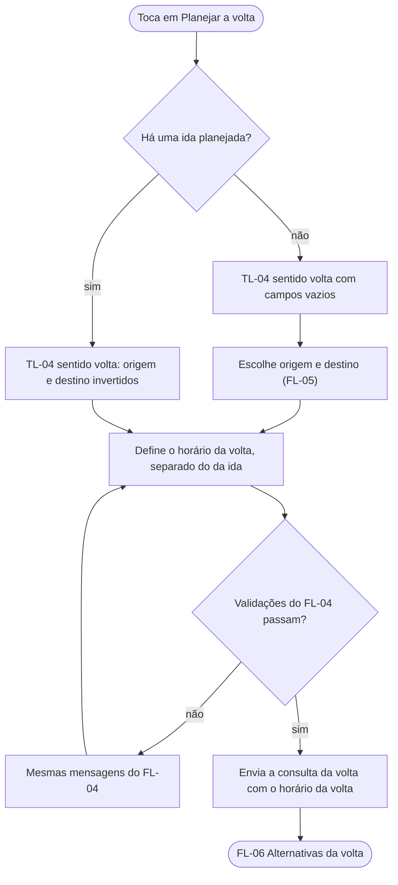

# FL-08 · Planejar a volta

- **Status:** rascunho · **Status das regras:** `[DECISÃO]` (US-07, DT-05)
- **Ator e gatilho:** Ágatha planejou a ida e toca em "Planejar a volta", ou abre TL-04 e muda o sentido para "volta".
- **Pré-condições:** sessão ativa; para a inversão automática, uma ida planejada nesta sessão.
- **Pós-condições:** consulta da volta enviada com o horário próprio (segue para FL-06).
- **US/AC cobertos:** US-07 AC1–AC2
- **Telas envolvidas:** TL-07/TL-08 → TL-04 (sentido volta) → TL-06 → TL-07

## Diagrama

## Passos

| Nº | Ação da usuária | Resposta do app | Tela | Dado/serviço |
|---|---|---|---|---|
| 1 | Toca em "Planejar a volta" | Abre TL-04 em "volta", com origem e destino invertidos | TL-04 | Local |
| 2 | Define o horário da volta (ex.: saída da faculdade) | Seletor de horário independente do da ida | TL-04 | Local |
| 3 | Toca em "Ver alternativas" | Valida e envia | TL-06 | API |
| 4 | — | Resultado da volta, calculado com a faixa do dia do horário da volta | TL-07 | Resposta da API |

## Caminho feliz

Ida planejada → inverter → novo horário → alternativas e comparação da volta.

## Caminhos alternativos

- Planejar só a volta, sem ida antes: campos vazios, sentido "volta".
- Trocar ida/volta no seletor de sentido de TL-04 a qualquer momento.

## Erros e exceções

As mesmas do FL-04 (campo vazio, fora do município, origem igual ao destino) e do FL-13.

## Regras de negócio e privacidade aplicáveis

- A volta usa o período da SSP do **horário da volta**, não o da ida (US-07 AC2, DT-05). Um trecho a pé depois de 0h conta como madrugada (`docs/08`).
- Ida e volta **não são alternativas entre si**: cada sentido tem a própria comparação (`docs/06` §3, teste 1).
- O app não guarda ida nem volta no servidor (US-19).
