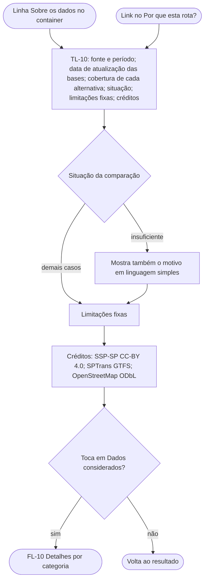

# FL-09 · Sobre os dados e fontes

- **Status:** rascunho · **Status das regras:** `[DECISÃO]` (US-14, US-16, `docs/08`, D-09)
- **Ator e gatilho:** Ágatha toca na **linha fixa** "Sobre os dados" do container (TL-07), sempre visível junto da comparação (D-09), ou no link dentro do "Por que esta rota?" (TL-09).
- **Pré-condições:** uma comparação exibida.
- **Pós-condições:** Ágatha conhece fonte, período, atualização, cobertura, situação e limitações, e volta ao resultado.
- **US/AC cobertos:** US-14 AC1–AC5; US-16 AC1–AC2; US-18 AC3
- **Telas envolvidas:** TL-07 ou TL-09 → TL-10 → TL-11 (opcional) → volta

## Diagrama

## Passos

| Nº | Ação da usuária | Resposta do app | Tela | Dado/serviço |
|---|---|---|---|---|
| 1 | Toca em "Sobre os dados" | Abre o bloco completo | TL-10 | Resposta da API (já carregada) |
| 2 | Lê | Fonte e período (ex.: "SSP-SP, boletins de jan–set/2026 (9 meses)"), data de atualização de cada base | TL-10 | Resposta da API |
| 3 | Lê | Cobertura de cada alternativa em percentual | TL-10 | Resposta da API |
| 4 | Lê | Situação da comparação (indicativo, com motivo quando faltar dado) | TL-10 | Resposta da API |
| 5 | Lê | Limitações e créditos | TL-10 | Texto fixo |
| 6 | Volta | Retorna ao ponto de onde veio | TL-07/TL-09 | — |

## Caminho feliz

Abre, lê e volta ao resultado.

## Caminhos alternativos

Vai a "Dados considerados" (FL-10).

## Erros e exceções

O conteúdo vem na mesma resposta da comparação; sem rede, abre do mesmo jeito. Se a resposta não trouxer o bloco, o app mostra só as limitações e créditos fixos e avisa que os números da comparação não estão disponíveis `[HIPÓTESE]`.

## Regras de negócio e privacidade aplicáveis

- **Limitações fixas** (US-14 AC5, `docs/08`): subnotificação (zero registro não é ausência de ocorrência); coordenadas podem ser pontos de referência; a contagem inclui todos os tipos de local; só furtos e roubos "outros"; horários programados que podem não refletir mudanças recentes.
- Sem nota, escala ou níveis (US-14 AC1, RNF-04).
- A situação usa a redação proposta, não validada (US-13 AC4), com os indicativos do FL-07 (mistos com o mesmo indicativo de "sem diferença clara", D-11).
- Crédito do GeoSampa (CC-BY-SA 4.0) só se a camada de iluminação for usada (US-16 AC2). No MVP ela não é usada (P-03, Posterior).
