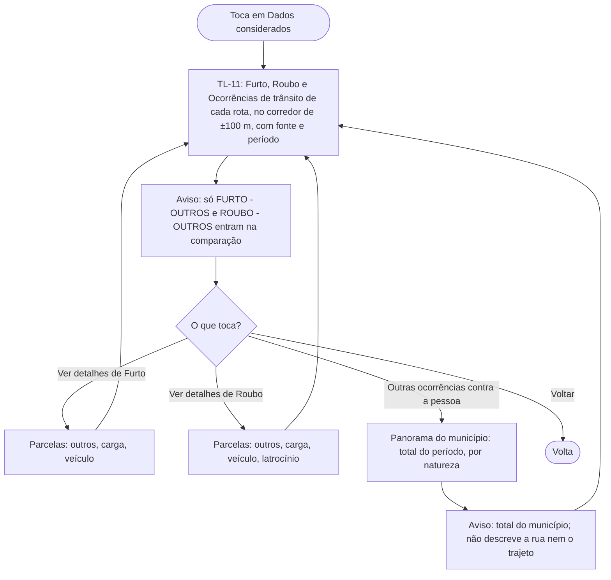

# FL-10 · Detalhes por categoria (Dados considerados)

- **Status:** rascunho · **Status das regras:** `[DECISÃO]` (US-15, `docs/07`, D-14)
- **Ator e gatilho:** Ágatha toca em "Dados considerados" em TL-10 ou no "Por que esta rota?" (TL-09).
- **Área dos totais (D-14):** por rota, no mesmo corredor de ±100 m dos trechos a pé usado em N. A tela principal não mostra números de ocorrência.
- **Pré-condições:** uma comparação exibida.
- **Pós-condições:** Ágatha viu os totais e parcelas e, se quis, o panorama municipal de outras ocorrências.
- **US/AC cobertos:** US-15 AC1–AC4
- **Telas envolvidas:** TL-10 → TL-11 → volta

## Diagrama

## Passos

| Nº | Ação da usuária | Resposta do app | Tela | Dado/serviço |
|---|---|---|---|---|
| 1 | Abre "Dados considerados" | Mostra os três grupos de cada rota, com fonte, período e área (corredor de ±100 m dos trechos a pé) | TL-11 | Resposta da API (D-14) |
| 2 | Toca em "Ver detalhes" | Abre as parcelas do grupo | TL-11 | Resposta da API |
| 3 | Toca em "Outras ocorrências contra a pessoa" (ação deliberada) | Mostra o total municipal por natureza, com aviso | TL-11 | Resposta da API |

## Caminho feliz

Vê os grupos e as parcelas e volta.

## Caminhos alternativos

Abre o panorama municipal de outras ocorrências.

## Erros e exceções

Contagem insuficiente ou com risco de identificação num recorte: não exibe o número e mostra "dados insuficientes" (`docs/07`). Sem dado do grupo na resposta: o grupo aparece como indisponível, nunca como zero.

## Regras de negócio e privacidade aplicáveis

- Os totais dos grupos **não** são apresentados como o valor comparado (US-15 AC2, `docs/07`).
- Homicídio doloso, tentativa de homicídio e violência sexual: só aqui, só como total do município, com aviso (US-15 AC3, `docs/05`).
- Sem marcadores individuais no mapa e sem filtros por rua, endereço ou data exata (US-15 AC4).
- Ocorrências de trânsito não são equiparadas a crime intencional (`docs/07`).
- Zero registro não é ausência de ocorrência (RNF-03).
