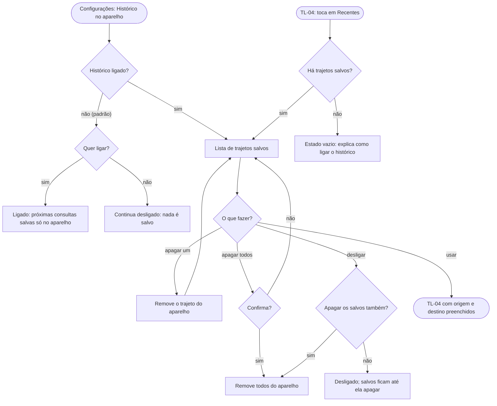

# FL-11 · Histórico local: ligar, usar, apagar

- **Status:** rascunho · **Status das regras:** `[DECISÃO]` (US-04, DT-08)
- **Ator e gatilho:** Ágatha abre Configurações → Histórico, ou toca em "Recentes" em TL-04.
- **Pré-condições:** sessão ativa.
- **Pós-condições:** histórico ligado ou desligado; trajeto reutilizado; ou trajetos apagados do aparelho.
- **US/AC cobertos:** US-04 AC1–AC4
- **Telas envolvidas:** TL-12 (Configurações) · TL-04 (Recentes)

## Diagrama

## Passos

| Nº | Ação da usuária | Resposta do app | Tela | Dado/serviço |
|---|---|---|---|---|
| 1 | Abre Configurações → Histórico | Mostra o interruptor (desligado por padrão) e a explicação | TL-12 | Armazenamento local |
| 2 | Liga o histórico | As próximas consultas passam a ser salvas no aparelho | TL-12 | Banco local |
| 3 | Apaga um ou todos | Remove do aparelho | TL-12 | Banco local |
| 4 | Usa um trajeto | Preenche TL-04 | TL-04 | Banco local |

## Caminho feliz

Liga → faz consultas → reutiliza um trajeto em TL-04.

## Caminhos alternativos

- Desligar e decidir se apaga o que já foi salvo `[HIPÓTESE]` (o backlog não define o que acontece com os salvos ao desligar).
- "Recentes" sem nada salvo: estado vazio.

## Erros e exceções

Falha ao gravar ou ler o banco local: aviso discreto; a consulta segue normalmente sem salvar `[HIPÓTESE]`.

## Regras de negócio e privacidade aplicáveis

- Desligado por padrão: nada é salvo (US-04 AC1).
- Só no armazenamento local; nunca enviado ao servidor nem vinculado à conta (US-04 AC2, AC4).
- Apagar remove de fato do aparelho (US-04 AC3).
