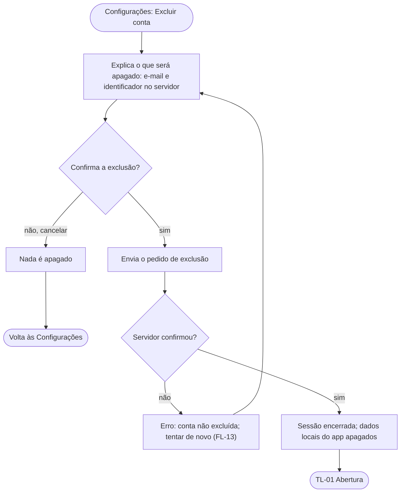

# FL-12 · Excluir conta

- **Status:** rascunho · **Status das regras:** `[DECISÃO]` (US-03, DT-08, D-03)
- **Ator e gatilho:** Ágatha abre Configurações → Excluir conta.
- **Pré-condições:** sessão ativa.
- **Pós-condições:** conta apagada no servidor e sessão encerrada; ou nada apagado, se ela cancelar.
- **US/AC cobertos:** US-03 AC1–AC3
- **Telas envolvidas:** TL-12 → confirmação → TL-01

## Diagrama

## Passos

| Nº | Ação da usuária | Resposta do app | Tela | Dado/serviço |
|---|---|---|---|---|
| 1 | Toca em "Excluir conta" | Explica o que será apagado e pede confirmação | TL-12 | — |
| 2 | Confirma | Chama a exclusão | TL-12 | Endpoint de exclusão (contrato, PL-05) |
| 3 | — | Encerra a sessão e volta à abertura | TL-01 | Sessão local apagada |

## Caminho feliz

Confirma → conta excluída → abertura (AC1). Tentar entrar depois com o mesmo e-mail e senha resulta em acesso negado (AC2, FL-03).

## Caminhos alternativos

Cancela a confirmação → nada é apagado (AC3).

## Erros e exceções

Sem rede ou erro do servidor: a conta **não** é dada como excluída; o app informa e permite tentar de novo.

## Regras de negócio e privacidade aplicáveis

- O servidor apaga e-mail e identificador (AC1, DT-08).
- Ao excluir a conta, o app também apaga sessão, histórico e locais salvos no aparelho `[HIPÓTESE]` (o backlog fala só do servidor).
- Exclusão operada só pelos desenvolvedores internos no servidor (DT-08); nenhum texto afirma conformidade com a LGPD (RNF-09).
