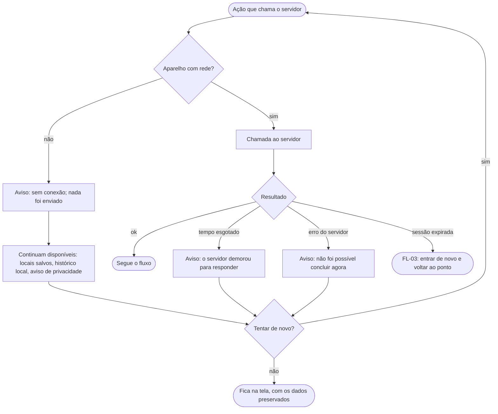

# FL-13 · Erros globais e sem rede

- **Status:** rascunho · **Status das regras:** `[HIPÓTESE]` (o backlog não define o comportamento offline; PL-12)
- **Ator e gatilho:** qualquer chamada ao servidor falha, ou o aparelho está sem rede.
- **Pré-condições:** qualquer tela que dependa do servidor.
- **Pós-condições:** Ágatha sabe o que aconteceu, o que digitou foi preservado e ela pode tentar de novo.
- **US/AC cobertos:** nenhum AC específico; aplica RNF-01, RNF-06 e RNF-07 às mensagens
- **Telas envolvidas:** TL-02, TL-03, TL-04, TL-06, TL-12 (estados de erro)

## Diagrama

## Passos

| Nº | Ação da usuária | Resposta do app | Tela | Dado/serviço |
|---|---|---|---|---|
| 1 | Faz uma ação que chama o servidor | Detecta a falha | Tela atual | — |
| 2 | — | Mostra o aviso com o botão "Tentar de novo" | Tela atual | — |
| 3 | Toca em "Tentar de novo" | Repete a chamada | Tela atual | Servidor |

## Caminho feliz

Rede volta → tenta de novo → segue o fluxo.

## Caminhos alternativos

Sessão expirada → login → retorno ao ponto onde parou.

## Erros e exceções

Este fluxo é a própria exceção. Mensagens sem código técnico e sem culpar a usuária (RNF-06).

## Regras de negócio e privacidade aplicáveis

- Mensagens de erro e logs do app sem coordenadas, endereços nem identificador da conta (US-19 AC2).
- Mensagens com rótulo acessível e anunciadas pelo leitor de tela (RNF-07).
- Na falha, o app não mostra comparação parcial nem resultado antigo como se fosse atual `[HIPÓTESE]`.
