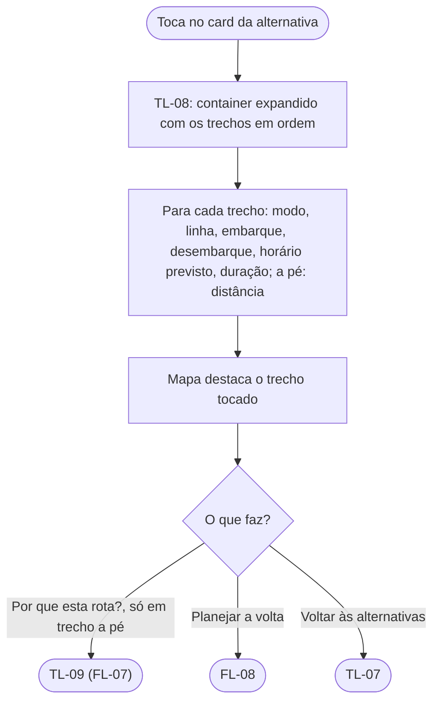

# FL-14 · Passo a passo

- **Status:** rascunho · **Status das regras:** `[DECISÃO]` (D-04: entra no MVP, só leitura); US-09
- **Ator e gatilho:** Ágatha toca num card de alternativa em TL-07 ou escolhe a alternativa.
- **Pré-condições:** uma alternativa exibida.
- **Pós-condições:** Ágatha vê os trechos em ordem, com embarque e desembarque.
- **US/AC cobertos:** US-09 AC1; US-08 AC1, AC3 (trechos com modo, linha e horário previsto)
- **Telas envolvidas:** TL-07 → TL-08 → TL-09 (opcional)

## Diagrama

## Passos

| Nº | Ação da usuária | Resposta do app | Tela | Dado/serviço |
|---|---|---|---|---|
| 1 | Toca no card | Expande o container com os trechos (ex.: a pé → metrô → a pé → ônibus → a pé) | TL-08 | Resposta da API |
| 2 | Toca num trecho | Destaca o trecho no mapa | TL-08 | Local |
| 3 | Toca em "Por que esta rota?" num trecho a pé (o botão só existe nesses trechos, D-08) | Abre os motivos | TL-09 | Resposta da API |

## Caminho feliz

Abre a alternativa e lê os trechos em ordem.

## Caminhos alternativos

Planeja a volta direto daqui (FL-08).

## Erros e exceções

Trecho sem nome de parada na resposta: mostra o modo e a linha, sem o nome `[HIPÓTESE]`.

## Regras de negócio e privacidade aplicáveis

- **Só leitura:** sem navegação ao vivo, sem acompanhar a posição (D-04, US-05 AC3).
- Horários identificados como previstos (US-08 AC3).
- Sem marcadores de ocorrência nos trechos (US-15 AC4).
