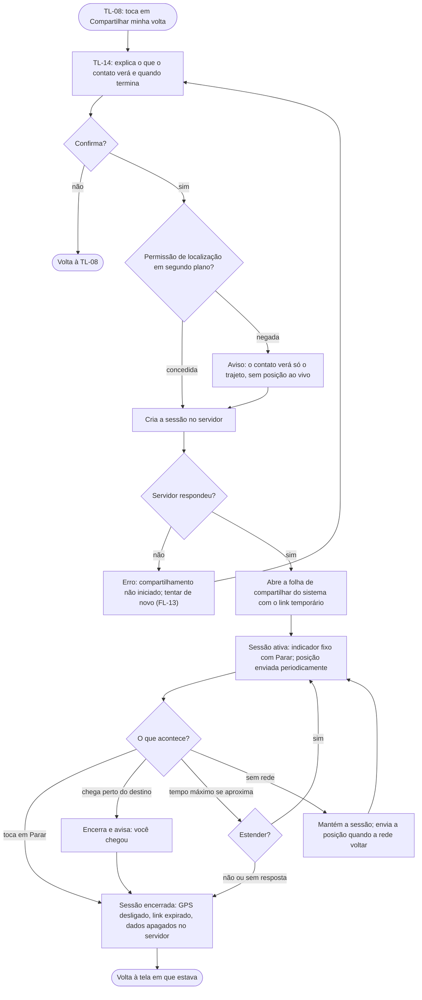

# FL-15 · Compartilhar minha volta (quem compartilha)

- **Status:** rascunho · **Depende do tempo (D-22)** · **Status das regras:** `[DECISÃO]` (D-19 a D-21, US-21); tempo máximo, frequência e chegada `[HIPÓTESE]` (PL-20 a PL-22); GPS em segundo plano no Expo Go a confirmar (PL-24)
- **Ator e gatilho:** Ágatha escolheu uma rota (TL-08) e toca em "Compartilhar minha volta".
- **Pré-condições:** sessão ativa no app; uma rota selecionada.
- **Pós-condições:** sessão de compartilhamento ativa com link enviado; ou encerrada (chegada, parada manual, tempo máximo), com os dados apagados no servidor.
- **US/AC cobertos:** US-21 AC1–AC5, AC7, AC9; US-05 AC3 (exceção); US-19 AC4
- **Telas envolvidas:** TL-08 → TL-14 (confirmar) → folha de compartilhar do sistema → TL-14 (sessão ativa) / indicador em todas as telas

## Diagrama

## Passos

| Nº | Ação da usuária | Resposta do app | Tela | Dado/serviço |
|---|---|---|---|---|
| 1 | Toca em "Compartilhar minha volta" | Explica o que será compartilhado e até quando | TL-14 | Local |
| 2 | Confirma | Pede a permissão de localização em segundo plano, se ainda não houver | TL-14 | Sistema |
| 3 | — | Cria a sessão e recebe o link | TL-14 | API (FN-15) |
| 4 | Escolhe o contato no WhatsApp, SMS etc. | Folha de compartilhar do sistema com o link | Sistema | — |
| 5 | Segue a viagem | Indicador fixo "Compartilhando · Parar"; posição enviada periodicamente | Todas | GPS + API |
| 6 | Toca em "Parar" ou chega | Encerra; GPS desligado; servidor apaga | TL-14 | API |

## Caminho feliz

Escolhe a rota → confirma → envia o link → viaja com o indicador visível → chega → a sessão encerra sozinha.

## Caminhos alternativos

- **Permissão negada:** compartilha só o trajeto, sem posição ao vivo (US-21 AC5, `[HIPÓTESE]`).
- **Estender** perto do tempo máximo (PL-20).
- **Parar a qualquer momento** pelo indicador.

## Erros e exceções

| Situação | Resposta | AC |
|---|---|---|
| Falha ao criar a sessão | Não inicia; "Tentar de novo" | — |
| Sem rede durante a sessão | Sessão mantida; posições reenviadas quando a rede volta; o contato vê "última atualização há X min" | — |
| App encerrado pelo sistema | A sessão continua no servidor até o tempo máximo; ao reabrir, o indicador volta `[HIPÓTESE]` | — |
| GPS em segundo plano indisponível no ambiente (PL-24) | Cai no caso "só o trajeto" ou a feature fica fora da demo (D-22) | — |

## Regras de negócio e privacidade aplicáveis

- **GPS em segundo plano só com a sessão ativa**, sempre com indicador e botão de parar (D-20; exceção ao US-05 AC3).
- **Servidor guarda trajeto e última posição só durante a sessão** e apaga tudo ao encerrar; logs sem coordenadas (D-21, US-19 AC4, AC2).
- O link expira ao encerrar (US-21 AC7).
- Nada de "volte em segurança" ou "o contato garante": a função é de acompanhamento, não de proteção (US-21 AC9, RNF-01, RNF-06).
