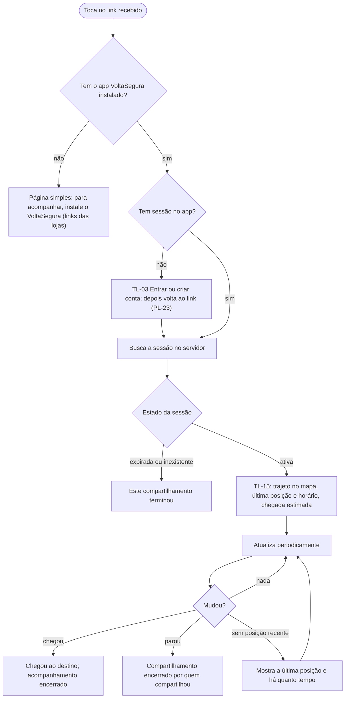

# FL-16 · Acompanhar uma viagem (quem recebe o link)

- **Status:** rascunho · **Depende do tempo (D-22)** · **Status das regras:** `[DECISÃO]` (D-21: link só abre no app); login do contato `[HIPÓTESE]` (PL-23)
- **Ator e gatilho:** um contato da Ágatha toca no link recebido.
- **Pré-condições:** link de uma sessão de compartilhamento.
- **Pós-condições:** o contato acompanha a viagem até o fim; ou é orientado a instalar o app; ou vê que o link expirou.
- **US/AC cobertos:** US-21 AC6–AC8
- **Telas envolvidas:** link → loja (sem app) · TL-03 (sem sessão) → TL-15

## Diagrama

## Passos

| Nº | Ação do contato | Resposta do app | Tela | Dado/serviço |
|---|---|---|---|---|
| 1 | Toca no link | Abre o app (ou a página de instalação) | — | Sistema |
| 2 | — | Pede login, se não houver sessão | TL-03 | FN-02 |
| 3 | — | Mostra o trajeto, a posição e a chegada estimada | TL-15 | API (FN-16) |
| 4 | Acompanha | Atualiza a posição e o estado | TL-15 | API |
| 5 | — | Mostra "Chegou" ou "Encerrado" | TL-15 | API |

## Caminho feliz

Link → app abre → TL-15 com a viagem em andamento → "Chegou".

## Caminhos alternativos

- Sem o app: orientação para instalar (US-21 AC6).
- Sem sessão: login e retorno ao link.
- Só trajeto (quem compartilha negou o GPS): TL-15 mostra o trajeto e a chegada estimada, sem posição, com a explicação.

## Erros e exceções

| Situação | Resposta |
|---|---|
| Link expirado ou inválido | "Este compartilhamento terminou." |
| Sem rede | Aviso; mantém a última informação com o horário dela |
| Sem posição recente | "Última atualização há X min" (PL-21); o app não faz suposições sobre o motivo |

## Regras de negócio e privacidade aplicáveis

- O contato vê **só** trajeto, última posição, chegada estimada e estado. Não vê dados da conta de quem compartilha nem os números da comparação (US-21 AC8, `[HIPÓTESE]`).
- Nada é guardado no aparelho do contato depois que a sessão termina `[HIPÓTESE]`.
- Sem marcadores de ocorrência nem rótulos de bairro no mapa (US-15 AC4, RNF-02).
- Textos sem alarme e sem culpa: "sem posição recente" não sugere perigo (RNF-01, RNF-06).
