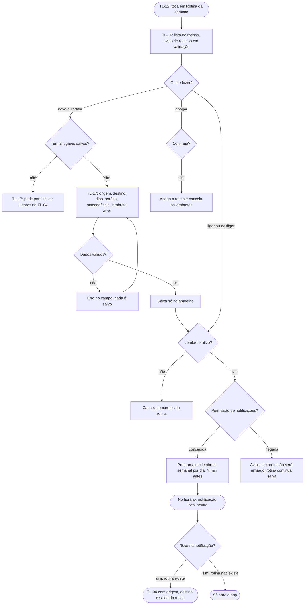

# FL-17 · Rotina da semana e lembrete antes de sair (VoltaSegura+)

> **Revisão D-36 (19/11/2026):** a rotina também é aberta pela home do VoltaSegura+ (FL-19). O horário é escolhido numa folha com rodas, sem teclado (decisão D-35, de 18/11).
>
> **Revisão D-31 (15/11/2026):** `[DECISÃO]` o VoltaSegura+ entra no MVP em versão mínima: rotina salva só no aparelho e **lembrete local por horário**, N minutos antes da saída (padrão 15), sem tempo real. Recurso **em validação**, sem preço. **Depende do tempo:** se o prazo de 19/11 apertar, vira roadmap sem afetar o resto.

- **Status:** rascunho (novo, 15/11/2026; aguarda revisão do Lucas) · **Depende do tempo (D-31)** · **Status das regras:** `[DECISÃO]` (D-31, `docs/10` F7.1/US-22); texto do lembrete, limite de 5 rotinas e opções de antecedência `[HIPÓTESE]`
- **Ator e gatilho:** Ágatha abre Configurações → Rotina da semana (TL-12), ou toca no lembrete recebido.
- **Pré-condições:** sessão ativa; pelo menos dois lugares salvos (FN-13) para escolher origem e destino.
- **Pós-condições:** rotina salva no aparelho e, se ativa e com permissão, lembretes semanais programados; ou rotina salva sem lembrete (permissão negada); ou TL-04 aberta com os dados da rotina.
- **US/AC cobertos:** US-22 AC1–AC5
- **Telas envolvidas:** TL-12 → TL-16 (lista) → TL-17 (criar ou editar) · notificação local → TL-04

## Diagrama

## Passos

| Nº | Ação da usuária | Resposta do app | Tela | Dado/serviço |
|---|---|---|---|---|
| 1 | Configurações → Rotina da semana | Lista com o selo "recurso em validação", privacidade e rotinas | TL-16 | Armazenamento local (FN-17) |
| 2 | "Nova rotina" | Formulário; sem 2 lugares salvos, pede para salvá-los antes | TL-17 | Lugares salvos (FN-13) |
| 3 | Escolhe origem, destino, dias, horário e antecedência | Valida ao salvar | TL-17 | Local |
| 4 | "Salvar rotina" (lembrete ativo) | Salva; pede a permissão de notificações **só agora**; programa os lembretes | TL-17 | `expo-secure-store`, notificações locais |
| 5 | Liga ou desliga o interruptor na lista | Programa ou cancela os lembretes da rotina | TL-16 | Notificações locais |
| 6 | Recebe o lembrete e toca | Abre TL-04 com origem, destino e saída de hoje no horário da rotina | TL-04 | Armazenamento local |

## Caminho feliz

Cria a rotina "Casa para Trabalho, dias úteis, 07:45" → aceita a permissão → recebe às 07:30 "Hora de sair: sua rotina de segunda-feira às 07:45. Compare os caminhos antes de sair." → toca → TL-04 já preenchida → "Ver alternativas".

## Caminhos alternativos

- Rotina salva com o lembrete desligado: nada é programado e a permissão não é pedida.
- Edição muda horário, dias ou antecedência: os lembretes antigos são cancelados e os novos programados.
- Aviso que cai antes da meia-noite (saída às 00:05 com 15 min): o lembrete vai para o dia anterior.
- Tocar no lembrete de uma rotina apagada: só abre o app.

## Erros e exceções

- **Permissão de notificações negada (US-22 AC4):** a rotina fica salva e o app informa que o lembrete não será enviado e como ativar nas configurações do aparelho.
- **Falha ao programar:** a rotina fica salva; aviso "não foi possível programar o lembrete agora".
- **Falha ao gravar:** "Não foi possível salvar a rotina agora." Nada muda.
- **Web (só desenvolvimento):** sem notificações; tratado como permissão negada.

## Regras de negócio e privacidade aplicáveis

- Rotina **só no aparelho** (`expo-secure-store`); nunca enviada ao servidor nem vinculada à conta (US-22 AC3, DT-08).
- A notificação leva só o id da rotina; coordenadas não vão no conteúdo.
- **Gatilho `[DECISÃO]`:** lembrete local N minutos antes do horário de saída, repetido nos dias escolhidos. Não usa trânsito, tempo real nem servidor; não promete mudança no resultado.
- Texto neutro; sem "rota segura", sem promessa de segurança, sem preço (US-22 AC5, RNF-01).
- Limite de 5 rotinas `[HIPÓTESE]`.
