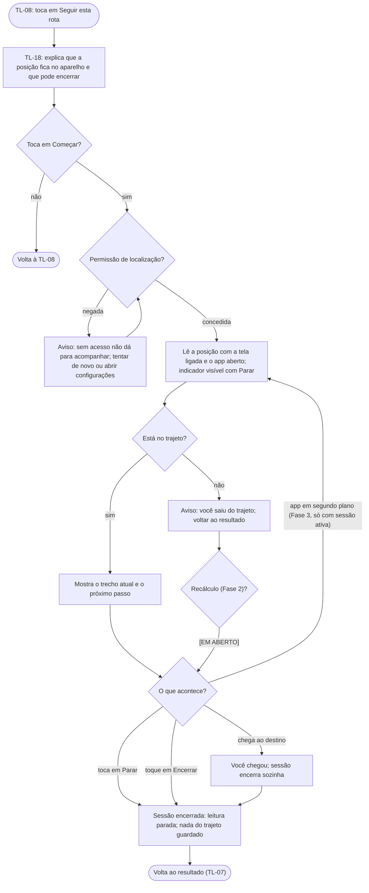

# FL-18 · Seguir rota (navegação no trajeto)

> **Revisão de 19/11/2026 — T25-B item 7 (D-39), só o trecho de compartilhamento:** `[DECISÃO]` a tela Seguir passa a ser o lugar do botão de compartilhamento (antes ficava na TL-08, ver FL-15). Os demais passos e regras desta página não mudam.

- **Status:** rascunho (18/11/2026) · **Status das regras:** `[DECISÃO]` (D-34: Fase 1 em primeiro plano, regime da D-20, posição só no aparelho pela D-21); recálculo (Fase 2) `[DECISÃO]` (D-34, itens 5 e 6); segundo plano (Fase 3) `[HIPÓTESE]` (PL-24); sem tempo máximo `[DECISÃO]` (D-34, item 7) e raio de chegada de 100 m (PL-22)
- **Implementação:** Fases 1, 2 e 3 implementadas no código, sem commit e sem validação no aparelho (`src/mobile-app/src/seguir/`, `src/mobile-app/src/app/(app)/seguir/[rotaId].tsx`); 71 testes passam (18/11/2026). Decisões em aberto: PL-28 a PL-32
- **Ator e gatilho:** Ágatha escolheu uma rota (TL-08) e toca em "Seguir esta rota".
- **Pré-condições:** uma rota com trajeto desenhado; app aberto.
- **Pós-condições:** sessão encerrada (chegada ou toque em "Encerrar"), sem trajeto guardado; a leitura de posição parou.
- **US/AC cobertos:** US-23 AC1–AC8; US-05 AC3 (revisto pela D-34); D-04 (revista)
- **Telas envolvidas:** TL-08 → TL-18 (intro, "Começar") → TL-18 (acompanhando) → TL-18 (chegou / encerrado) → volta ao resultado (TL-07)

## Diagrama

## Passos

| Nº | Ação da usuária | Resposta do app | Tela | Dado/serviço |
|---|---|---|---|---|
| 1 | Toca em "Seguir esta rota" | Explica o que é lido, onde fica a posição e que pode encerrar | TL-18 | Local |
| 2 | Toca em "Começar" | Pede a permissão de localização, se ainda não concedida | TL-18 | Sistema |
| 3 | — | Mostra "Procurando sua posição…" e depois o trecho atual e o próximo passo | TL-18 | GPS (aparelho) |
| 4 | Segue o trajeto | Atualiza o trecho e o próximo passo; indicador "Acompanhando sua posição" fica visível | TL-18 | GPS (aparelho) |
| 5 | Toca em "Parar" ou chega | Encerra a leitura; nada do trajeto é guardado | TL-18 | — |

Se a pessoa estiver compartilhando a viagem (F2.5), a posição também é enviada ao compartilhamento, como já previsto pela D-21. Fora disso, a posição não sai do aparelho.

## Caminho feliz

Escolhe a rota → "Seguir esta rota" → "Começar" → acompanha os passos → chega → a sessão encerra sozinha.

## Caminhos alternativos

- **Permissão negada:** a tela explica que sem acesso à localização não dá para acompanhar, e oferece tentar de novo ou abrir as configurações. Nenhuma posição é lida.
- **Fora do trajeto:** o app avisa e oferece voltar ao resultado. O recálculo a partir da posição atual é a Fase 2 e fica `[EM ABERTO]` (D-34, item 6).
- **Parar a qualquer momento** pelo indicador.
- **Segundo plano (Fase 3):** a leitura continua só com a sessão ativa, com indicador visível (D-20). `[HIPÓTESE]` (PL-24).

## Erros e exceções

| Situação | Resposta | AC |
|---|---|---|
| Não foi possível ler a posição agora | "Não foi possível ler sua posição agora. Tente de novo." | AC1 |
| Rota sem trajeto desenhado | "Esta rota não tem trajeto desenhado para acompanhar." Não inicia | AC1 |
| GPS indisponível em segundo plano no ambiente (PL-24) | A leitura para e o app informa; a Fase 3 não entra na demo sem o teste | AC6 |

## Regras de negócio e privacidade aplicáveis

- **Leitura só depois de tocar em "Começar"**, com a tela ligada e o app aberto na Fase 1 (D-34; revisão da US-05 AC3).
- **Em segundo plano, só com a sessão ativa**, com indicador sempre visível e botão "Parar", no mesmo regime da D-20.
- **Sem histórico:** o trajeto percorrido e as posições não são guardados no aparelho nem enviados ao servidor (D-34, item 3).
- **A posição fica no aparelho**, exceto no compartilhamento por opt-in (D-21).
- **Recálculo não envia a posição a nenhum serviço** até haver decisão registrada (D-34, item 6).
- Nenhum texto diz que a navegação garante segurança nem que o trajeto é "seguro" (`docs/05`, RNF-01).

## Revisão de 19/11/2026 — pós-teste no aparelho (itens 8 e 9)
- Antes de "Começar": se a preferência "não mostrar de novo" estiver gravada, a intro é pulada; senão a intro aparece com a caixa "Entendi e não mostrar de novo". Ao tocar "Começar" com a caixa marcada, grava-se a preferência.
- Ao encerrar, "Fechar" leva direto à home (`dismissAll()` + `replace('/planejar')`).
