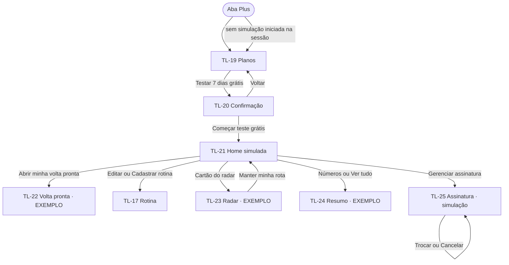

# FL-19 · VoltaSegura+: simulação, exemplos e aba Plus (D-36)

> **Revisão D-36 (19/11/2026):** fluxo novo. `[DECISÃO]` o VoltaSegura+ aparece como **simulação sem cobrança** (planos, teste de 7 dias e assinatura), com a rotina real do aparelho (D-31) e telas de **exemplo** (radar, resumo, volta pronta). Nada é cobrado, guardado ou enviado por este fluxo.

- **Status:** pronto para o protótipo (19/11/2026; aguarda revisão do Lucas) · **Simulação (D-36)** · revê o item 3 da D-31
- **Ator e gatilho:** a pessoa toca na aba Plus da barra inferior.
- **Pré-condições:** sessão ativa (FL-03).
- **Pós-condições:** nenhuma. Nada é gravado; a rotina só é lida ou editada pelo fluxo da FL-17.
- **US/AC cobertos:** FN-21; FN-17 (rotina, pelo link da home).
- **Telas envolvidas:** TL-19, TL-20, TL-21, TL-22, TL-23, TL-24, TL-25; TL-17 pelo link da rotina.

## Diagrama

## Passos

1. A aba Plus abre a TL-19 (planos). Nenhum dado é lido.
2. "Testar 7 dias grátis" leva à TL-20 com o plano escolhido (parâmetro de navegação).
3. "Começar teste grátis" substitui a TL-20 pela TL-21. Nada é gravado: se a pessoa sair e voltar, a aba Plus abre de novo na TL-19.
4. A TL-21 mostra a rotina mais recente ativa do aparelho (FN-17) ou o convite a cadastrar uma.
5. Radar, resumo e volta pronta são exemplos (EXEMPLO); não há cálculo nem chamada ao servidor.
6. Trocar de plano e cancelar, na TL-25, só mostram um aviso de simulação.

## Erros e casos de borda

- Rotina lida antes do fim do carregamento: a TL-21 mostra o cartão vazio, sem texto de "sem rotina", até o aparelho responder.
- Nenhum erro de rede: esta feature não usa a rede.

## Regras

- `[DECISÃO]` Nenhuma cobrança, nenhum dado de pagamento e nenhum valor guardado ou enviado.
- `[DECISÃO]` Selo "Demonstração: nenhuma cobrança real" em TL-19, TL-20 e TL-25; selo EXEMPLO em TL-22, TL-23 e TL-24.
- `[HIPÓTESE]` A aba Plus abre sempre a TL-19: a simulação não guarda estado entre aberturas do app (PL-35).

## Dados

- Rotina: aparelho (FN-17). Nada mais é lido.
- Preços, textos e exemplos: `src/textos/plus.ts` e `src/plus/exemplos.ts`.
