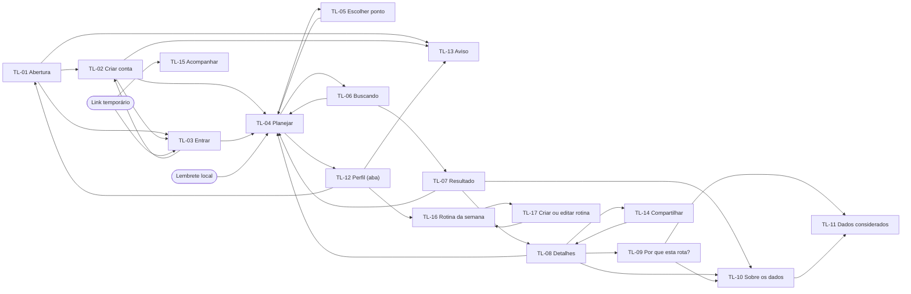

# Navegação

- **Status:** rascunho (Fase 2, 13/11/2026)
- **Base:** Expo Router (DT-11). As rotas são **previstas** e podem ser ajustadas na construção. Uma mudança de rota deve ser anotada aqui e na tela correspondente.
- **Construção (13/11/2026):** a árvore abaixo foi implementada como está, mas dentro de `src/mobile-app/src/app/` (e não em `app/`), para manter o código que não é rota fora da pasta de rotas. As URLs não mudam. Detalhes em `src/mobile-app/ARQUITETURA.md`.

## Árvore de rotas

```
app/
├── _layout.tsx                 raiz: provedores (sessão, rede, modo mock|api), guarda de sessão
├── aviso-privacidade.tsx       TL-13 (com ou sem sessão)
├── (auth)/                     sem sessão
│   ├── _layout.tsx             pilha sem cabeçalho de app
│   ├── index.tsx               TL-01 Abertura
│   ├── criar-conta.tsx         TL-02
│   └── entrar.tsx              TL-03
└── (app)/                      exige sessão
    ├── _layout.tsx             pilha; redireciona para (auth) sem sessão
    ├── planejar.tsx            TL-04 (tela inicial com sessão)
    ├── escolher-ponto.tsx      TL-05 (modal; ?campo=origem|destino)
    ├── buscando.tsx            TL-06 (substituída no sucesso)
    ├── resultado/
    │   ├── index.tsx           TL-07
    │   └── [rotaId].tsx        TL-08
    ├── por-que/
    │   └── [rotaId]/[trechoId].tsx   TL-09 (modal)
    ├── sobre-os-dados.tsx      TL-10
    ├── dados-considerados.tsx  TL-11 (?rotaId=)
    ├── (abas)/perfil.tsx       TL-12 (aba Perfil, D-38)
    ├── rotina.tsx              TL-16 (Depende do tempo, D-31)
    ├── rotina/
    │   └── editar.tsx          TL-17 (?id= ao editar)
    ├── compartilhar/
    │   └── [rotaId].tsx        TL-14 (modal; Depende do tempo)
    └── acompanhar/
        └── [token].tsx         TL-15 (aberta pelo link; Depende do tempo)
```

## Mapa de navegação



## Transições e comportamento de voltar

| De → para | Tipo | Voltar |
|---|---|---|
| TL-01 → TL-02/TL-03 | pilha | volta à TL-01 |
| TL-02/TL-03 → TL-04 | **substitui** a pilha (auth → app) | não volta ao login |
| TL-04 → TL-05 | modal em tela cheia (De onde, Para onde ou Adicionar lugar; sem menu intermediário, D-29) | fecha sem mudar o campo |
| TL-04 → TL-06 | pilha | cancela a consulta |
| TL-06 → TL-07 | **substitui** a TL-06 | da TL-07, volta à TL-04 com os campos mantidos |
| TL-07 → TL-08 | expande o container (rota com parâmetro) | recolhe para a TL-07 |
| TL-08 → TL-09 | modal | fecha para a TL-08 |
| TL-07/08/09 → TL-10 → TL-11 | pilha | volta à origem |
| TL-07/TL-08 → TL-04 ("Planejar a volta") | pilha, com `sentido=volta` e pontos invertidos | volta ao resultado anterior |
| TL-12 → TL-01 (sair ou excluir; excluir: adiado, D-25) | **substitui** tudo | — |
| TL-12 → TL-16 → TL-17 | pilha (D-31) | volta à tela anterior; salvar sem permissão volta à TL-16 com aviso (`?aviso=`) |
| Toque no lembrete → TL-04 | **navega** para a TL-04 com origem, destino e saída da rotina já na consulta; se a rotina não existe mais, só abre o app (D-31) | segue o comportamento normal da TL-04 |
| TL-08 → TL-14 | modal | fecha para a TL-08; a sessão de compartilhamento continua ativa |
| Link temporário → TL-15 | **deep link** no app; sem sessão, passa pela TL-03 e volta ao link (PL-23); sem o app, página de instalação | volta à TL-04 do contato |
| Qualquer tela de (app) com sessão expirada | vai para TL-03 guardando a rota | depois do login, retorna à rota guardada |

No Android, o botão físico de voltar segue a coluna "Voltar".

## Estados globais

| Estado | Onde vive | Quem usa |
|---|---|---|
| Sessão (token, expiração, e-mail) | Armazenamento seguro + contexto | Guarda de rotas, TL-12, chamadas à API |
| Consulta atual (origem, destino, horário, sentido) | Memória (contexto) | TL-04, TL-06, TL-07; **nunca** vai para log nem para o servidor além da consulta |
| Resposta da consulta | Memória | TL-07 a TL-11; descartada numa nova consulta e ao sair |
| Rota selecionada | Memória | TL-07, TL-08 |
| Conectividade | Contexto | Avisos de FL-13 |
| Modo `mock`/`api` | Configuração do app | Camada de serviços |
| Locais salvos | `expo-secure-store` no aparelho (FN-13, D-29); histórico de trajetos `[EM ABERTO]` | TL-04, TL-05, TL-12 |
| Rotinas da semana | `expo-secure-store` no aparelho, chave `voltasegura.rotinas` (FN-17, D-31); lembretes programados no sistema (notificações locais) | TL-16, TL-17, abertura pelo lembrete |
| Sessão de compartilhamento ativa (id, link, início, tempo máximo) | Memória + armazenamento seguro, para retomar se o app for reaberto `[HIPÓTESE]` | Indicador global em todas as telas de `(app)`, TL-14 |
| Tarefa de localização em segundo plano | Sistema (só com sessão ativa, D-20) | FN-15 |

## Guardas

- Sem sessão, qualquer rota de `(app)` redireciona para TL-01 (US-02 AC3).
- Com sessão, abrir o app leva direto à TL-04.
- **Indicador global de compartilhamento:** enquanto a sessão estiver ativa, fica fixo no topo de todas as telas de `(app)` e não pode ser escondido (D-20).
- TL-07 a TL-11 sem resposta em memória (ex.: o app foi reaberto) redirecionam para TL-04 `[HIPÓTESE]`.


## Abas e VoltaSegura+ (D-36, 19/11/2026)

`[DECISÃO]` A barra inferior tem cinco abas. A aba **Planejar** é a home de busca (TL-04). Telas de fluxo (escolher ponto, resultado, por que, buscando, seguir, compartilhar, rotina/editar e as telas do Plus) ficam fora das abas, como pilha ou modal.

| Aba | Rota | Tela | Observação |
|---|---|---|---|
| Planejar | `/(app)/planejar` | TL-04 | home de busca (inalterada) |
| Locais | `/(app)/locais` | TL-26 | salvar abre `/(app)/escolher-ponto` (TL-05) |
| Contatos | `/(app)/contatos` | TL-27 | só nomes |
| Plus | `/(app)/plus/index` | TL-19 | planos; o teste leva a `/(app)/plus/confirmacao` (TL-20) e depois a `/(app)/plus/home` (TL-21) |
| Perfil | `/(app)/(abas)/perfil` | TL-12 | conta, status do VoltaSegura+, atalho da rotina, tema, privacidade e sair (D-38); `/(app)/configuracoes` foi removida |

Caminhos a partir da TL-21 (pilha): `/(app)/plus/volta-pronta` (TL-22), `/(app)/plus/radar` (TL-23), `/(app)/plus/resumo` (TL-24), `/(app)/plus/assinatura` (TL-25), `/(app)/rotina/editar` (TL-17).

`[DECISÃO]` As abas ficam no grupo `src/app/(app)/(abas)/` (`planejar`, `locais`, `contatos`, `plus`, `perfil`), com `Tabs` e a `BarraAbas` em `(abas)/_layout.tsx`. A pilha do `(app)/_layout.tsx` abre em `(abas)` e guarda as telas de fluxo (resultado, modais, Plus de pilha, seguir, compartilhar). As URLs não mudam: o grupo não entra no caminho (`/planejar` continua `/planejar`).


## Revisão D-38 (19/11/2026, T25-B): sem Configurações e com portão na aba Plus

- `/(app)/configuracoes` deixa de existir. Quem chegava por ela encontra a aba Perfil (conta, Plus, Rotina, tema, privacidade, sair) e a aba Locais (renomear e apagar lugares).
- A aba Plus (`/(app)/(abas)/plus`) mostra a home (TL-21) quando há assinatura simulada; sem ela, os planos (TL-19). `/plus/home` continua existindo como tela de pilha.
- Depois de cancelar a simulação (TL-25), a navegação volta para `/plus`.

## Revisão de 19/11/2026 (T25-B, D-39 e itens 8 e 9)

- **Compartilhar sai do detalhe da rota (TL-08 → TL-14 deixa de existir):** o caminho passa a ser TL-18 Seguir → `/compartilhar/[rotaId]` (TL-14), pelo botão "Compartilhar minha volta" no cartão de acompanhamento, só depois de começar o trajeto (D-39). O `IndicadorCompartilhamento` continua abrindo a TL-14 quando há compartilhamento ativo.
- **"Planejar a volta" sai do resultado e do detalhe:** `[EM ABERTO]` novo caminho para a volta (FL-08, US-07 AC1).
- **Fechar no Seguir (TL-18) volta direto à home:** `router.dismissAll()` e `router.replace('/planejar')`, sem passar de volta pelo detalhe e pelo resultado.
- **Aviso de início do Seguir:** pode ser ocultado com "Entendi e não mostrar de novo" (preferência só no aparelho).
