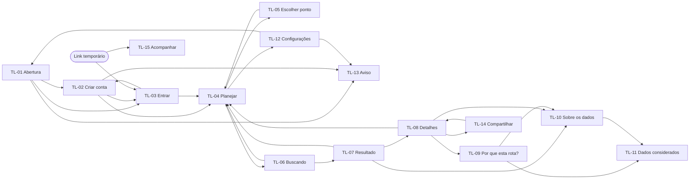

# Navegação

- **Status:** rascunho (Fase 2, 13/11/2026)
- **Base:** Expo Router (DT-11). As rotas são **previstas** e podem ser ajustadas na construção. Uma mudança de rota deve ser anotada aqui e na tela correspondente.

## Árvore de rotas

```
app/
├── _layout.tsx                 raiz: provedores (sessão, rede, modo mock|api), guarda de sessão
├── aviso-privacidade.tsx       TL-13 (com ou sem sessão)
├── (auth)/                     sem sessão
│   ├── _layout.tsx             pilha sem cabeçalho de app
│   ├── index.tsx               TL-01 Abertura
│   ├── criar-conta.tsx         TL-02
│   └── entrar.tsx              TL-03
└── (app)/                      exige sessão
    ├── _layout.tsx             pilha; redireciona para (auth) sem sessão
    ├── planejar.tsx            TL-04 (tela inicial com sessão)
    ├── escolher-ponto.tsx      TL-05 (modal; ?campo=origem|destino)
    ├── buscando.tsx            TL-06 (substituída no sucesso)
    ├── resultado/
    │   ├── index.tsx           TL-07
    │   └── [rotaId].tsx        TL-08
    ├── por-que/
    │   └── [rotaId]/[trechoId].tsx   TL-09 (modal)
    ├── sobre-os-dados.tsx      TL-10
    ├── dados-considerados.tsx  TL-11 (?rotaId=)
    ├── configuracoes.tsx       TL-12
    ├── compartilhar/
    │   └── [rotaId].tsx        TL-14 (modal; Depende do tempo)
    └── acompanhar/
        └── [token].tsx         TL-15 (aberta pelo link; Depende do tempo)
```

## Mapa de navegação



## Transições e comportamento de voltar

| De → para | Tipo | Voltar |
|---|---|---|
| TL-01 → TL-02/TL-03 | pilha | volta à TL-01 |
| TL-02/TL-03 → TL-04 | **substitui** a pilha (auth → app) | não volta ao login |
| TL-04 → TL-05 | modal | fecha sem mudar o campo |
| TL-04 → TL-06 | pilha | cancela a consulta |
| TL-06 → TL-07 | **substitui** a TL-06 | da TL-07, volta à TL-04 com os campos mantidos |
| TL-07 → TL-08 | expande o container (rota com parâmetro) | recolhe para a TL-07 |
| TL-08 → TL-09 | modal | fecha para a TL-08 |
| TL-07/08/09 → TL-10 → TL-11 | pilha | volta à origem |
| TL-07/TL-08 → TL-04 ("Planejar a volta") | pilha, com `sentido=volta` e pontos invertidos | volta ao resultado anterior |
| TL-12 → TL-01 (sair ou excluir) | **substitui** tudo | — |
| TL-08 → TL-14 | modal | fecha para a TL-08; a sessão de compartilhamento continua ativa |
| Link temporário → TL-15 | **deep link** no app; sem sessão, passa pela TL-03 e volta ao link (PL-23); sem o app, página de instalação | volta à TL-04 do contato |
| Qualquer tela de (app) com sessão expirada | vai para TL-03 guardando a rota | depois do login, retorna à rota guardada |

No Android, o botão físico de voltar segue a coluna "Voltar".

## Estados globais

| Estado | Onde vive | Quem usa |
|---|---|---|
| Sessão (token, expiração, e-mail) | Armazenamento seguro + contexto | Guarda de rotas, TL-12, chamadas à API |
| Consulta atual (origem, destino, horário, sentido) | Memória (contexto) | TL-04, TL-06, TL-07; **nunca** vai para log nem para o servidor além da consulta |
| Resposta da consulta | Memória | TL-07 a TL-11; descartada numa nova consulta e ao sair |
| Rota selecionada | Memória | TL-07, TL-08 |
| Conectividade | Contexto | Avisos de FL-13 |
| Modo `mock`/`api` | Configuração do app | Camada de serviços |
| Histórico e locais salvos | Banco local (FN-13) | TL-04, TL-05, TL-12 |
| Sessão de compartilhamento ativa (id, link, início, tempo máximo) | Memória + armazenamento seguro, para retomar se o app for reaberto `[HIPÓTESE]` | Indicador global em todas as telas de `(app)`, TL-14 |
| Tarefa de localização em segundo plano | Sistema (só com sessão ativa, D-20) | FN-15 |

## Guardas

- Sem sessão, qualquer rota de `(app)` redireciona para TL-01 (US-02 AC3).
- Com sessão, abrir o app leva direto à TL-04.
- **Indicador global de compartilhamento:** enquanto a sessão estiver ativa, fica fixo no topo de todas as telas de `(app)` e não pode ser escondido (D-20).
- TL-07 a TL-11 sem resposta em memória (ex.: o app foi reaberto) redirecionam para TL-04 `[HIPÓTESE]`.
