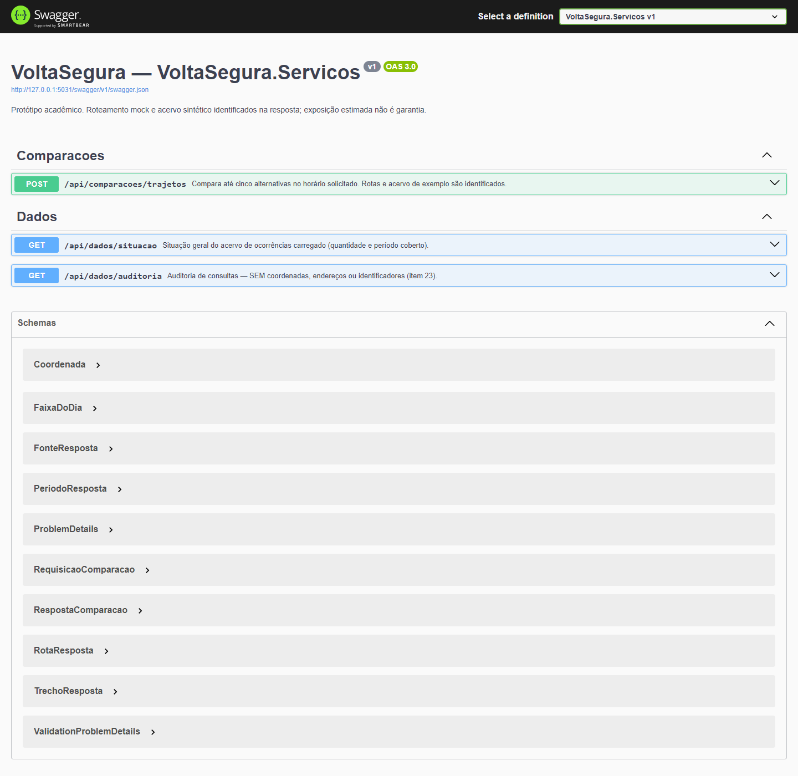
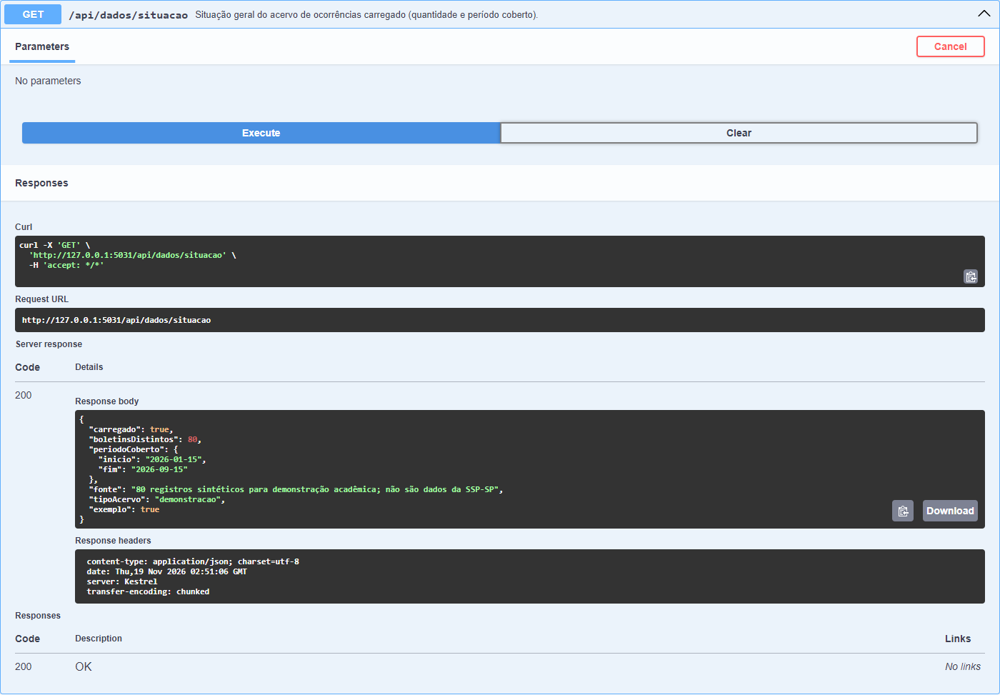
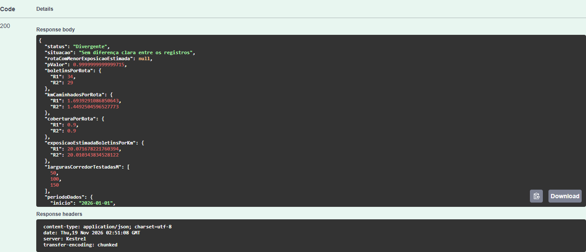

# Evidências de execução — SOA e C#

Verificação local de 18/11/2026 (São Paulo; timestamps UTC nos arquivos). **Tudo nesta demonstração usa rotas mock e 80 registros sintéticos**, não BOs reais. Os arquivos foram produzidos executando a aplicação, sem simular resultados de comandos.

## Resultado observado

- Build da solution aprovado, sem avisos nem erros na execução registrada.
- **46 testes aprovados**, zero falhas e zero ignorados.
- Duas migrações aplicadas em um banco novo; reaplicação sem alterações.
- Acervo vazio identificado antes da carga; 80 registros fictícios após a carga.
- Comparação com HTTP 200; pedido inválido com HTTP 400.
- Auditoria sem coordenadas ou conta; registro preservado após encerrar e reiniciar o processo da API.
- API C# consultada por HTTP com agregados; histórico no servidor desativado por padrão (403).
- [EM ABERTO] Servidor OTP2 ao vivo, carga SSP real e integração completa com o app não foram validados. Os testes de contrato OTP usam respostas controladas.

## Capturas reais do Swagger







A última captura mostra apenas a parte visível do JSON. A resposta completa, incluindo `fontes.exemplo`, está no arquivo de comparação abaixo. “Sem diferença clara entre os registros” é o resultado desta consulta sintética, não uma conclusão sobre os locais do exemplo.

## Arquivos verificáveis

| Evidência | Arquivo |
|---|---|
| Compilação | [01-build.txt](01-build.txt) |
| Testes | [02-testes.txt](02-testes.txt) |
| Migrações no banco novo | [03-migracao.txt](03-migracao.txt) |
| Reaplicação idempotente | [04-migracao-idempotente.txt](04-migracao-idempotente.txt) |
| Banco vazio | [05-banco-vazio.json](05-banco-vazio.json) |
| Carga fictícia | [06-carga-sintetica.txt](06-carga-sintetica.txt) |
| OpenAPI SOA | [07-openapi-soa.json](07-openapi-soa.json) |
| Acervo carregado | [08-acervo-demonstracao.json](08-acervo-demonstracao.json) |
| Pedido e resposta da comparação | [09-comparacao.json](09-comparacao.json) |
| Entrada inválida | [10-validacao-400.json](10-validacao-400.json) |
| Auditoria | [11-auditoria.json](11-auditoria.json) |
| Auditoria após reinício | [12-auditoria-apos-reiniciar.json](12-auditoria-apos-reiniciar.json) |
| Consulta C# | [13-csharp-ocorrencias.json](13-csharp-ocorrencias.json) |
| Histórico desativado | [14-historico-desativado.json](14-historico-desativado.json) |
| OpenAPI C# | [15-openapi-csharp.json](15-openapi-csharp.json) |
| Resumo da execução | [resultado.json](resultado.json) |

## Reproduzir

Com .NET e Python 3 instalados, na pasta `src/csharp-backend`:

```powershell
python scripts/verificar_entrega.py
```

O script cria um banco exclusivo de verificação em `dados/`, inicia APIs locais em portas livres, realiza as chamadas, encerra os processos e salva os resultados. Não faz download de dados, commit, push nem envio ao Teams. As capturas podem ser refeitas seguindo o roteiro do Swagger no README SOA.
